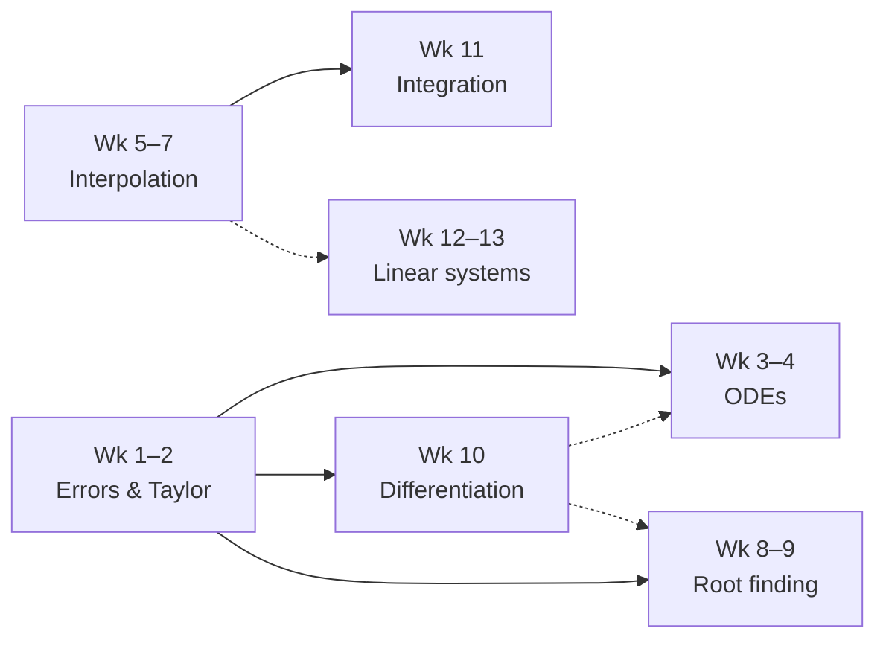

# MXB103 Revision: Introductory Computational Mathematics

Exam revision notes for **QUT MXB103** (Semester 2, 2026). There's one page per week, a page explaining what each numerical method is actually for, and an exam playbook built from the 2023–2025 past papers.

> **Where to start:** read [the big picture](notes/00_big_picture_methods.md) first, then work through the weeks, and finish with [the exam playbook](notes/99_exam_playbook.md).



## Contents

| File | Topic | Exam questions |
|---|---|---|
| [notes/00_big_picture_methods.md](notes/00_big_picture_methods.md) | **What each method really does**: input → output → purpose | all |
| [notes/week01_errors_floating_point.md](notes/week01_errors_floating_point.md) | Absolute/relative error, binary, $F(\beta,k,m,M)$, unit roundoff | Q1 |
| [notes/week02_cancellation_taylor.md](notes/week02_cancellation_taylor.md) | Catastrophic cancellation, Taylor polynomials, error bounds | Q1, Q2 |
| [notes/week03_odes_euler.md](notes/week03_odes_euler.md) | Initial value problems, Euler's method, local vs global error | Q3, Q5 |
| [notes/week04_higher_order_ode_methods.md](notes/week04_higher_order_ode_methods.md) | 2nd-order Taylor, Modified Euler, RK4 | Q3, Q4, Q5 |
| [notes/week05_interpolation_lagrange.md](notes/week05_interpolation_lagrange.md) | Interpolation, Lagrange form, remainder | Q6 |
| [notes/week06_newton_divided_differences.md](notes/week06_newton_divided_differences.md) | Newton divided differences | Q8 |
| [notes/week07_newton_forward_differences.md](notes/week07_newton_forward_differences.md) | Newton forward differences, extrapolation | Q7, Q8 |
| [notes/week08_bisection_fixed_point.md](notes/week08_bisection_fixed_point.md) | Bisection, fixed point iteration | Q9, Q10 |
| [notes/week09_newton_secant.md](notes/week09_newton_secant.md) | Newton's method, secant method, convergence rates | Q9–Q11 |
| [notes/week10_numerical_differentiation.md](notes/week10_numerical_differentiation.md) | Forward/backward/central differences, choosing $h$ | Q11, Q12 |
| [notes/week11_numerical_integration.md](notes/week11_numerical_integration.md) | Trapezoidal and Simpson's rules | Q13, Q14 |
| [notes/week12_lu_factorisation.md](notes/week12_lu_factorisation.md) | Forward/backward substitution, LU factorisation | Q15 |
| [notes/week13_cholesky.md](notes/week13_cholesky.md) | SPD matrices, Cholesky factorisation | Q16 |
| [notes/formula_sheet.md](notes/formula_sheet.md) · [**PDF**](notes/formula_sheet.pdf) | **Formula sheet**: every formula to memorise, each with a short meaning, a worked example and edge cases (21-page LaTeX PDF for printing) | all |
| [**notes/cheat_sheet.pdf**](notes/cheat_sheet.pdf) | **Exam cheat sheet**: one A4 sheet, double-sided. Side 1 covers Q1–Q8 (Weeks 1–7), side 2 covers Q9–Q16 (Weeks 8–13) plus the MATLAB bug checklist | the exam |
| [**notes/derivations.pdf**](notes/derivations.pdf) | **Derivations**: every derivable formula, one numbered step at a time, with the official mark split on exam derivations and ★★★ priority stars (37 pages) | Q1b, Q2, Q5, Q8, Q10, Q11, Q13, Q15, Q16 |
| [notes/99_exam_playbook.md](notes/99_exam_playbook.md) | Question map, MATLAB bug catalogue, derivations, A4 sheet plan | all |

Each week page follows the same layout: **the point → diagram → formulas → derivations → worked examples → step-by-step walkthroughs → traps → practice questions** (answers are hidden in collapsible sections).

The **step-by-step walkthroughs** break each method into numbered steps, saying what you do and *why*. They then work 2–3 extra examples where every line is labelled with the step it performs.

## Practice exams

Two full papers in the real exam's format (16 questions, 80 marks, 3 MATLAB bug-fix questions), with fully worked, mark-annotated solutions:

| Paper | Solutions | Covers |
|---|---|---|
| [Practice Exam 1](practice_exams/practice_exam_1.md) | [Solutions](practice_exams/practice_exam_1_solutions.md) | Modified Euler, Taylor 2 derivation, Lagrange + bound, secant & Simpson MATLAB bugs, Newton for $\sqrt[4]a$ |
| [Practice Exam 2](practice_exams/practice_exam_2.md) | [Solutions](practice_exams/practice_exam_2_solutions.md) | Taylor 2, Modified Euler derivation, RK4 & fixed-point & Lagrange MATLAB bugs, secant for $\sqrt[3]a$, Simpson derivation |

Do them **timed (3 hours)** after the 2023–2025 papers.

## Exam at a glance

- 3 hours + 10 min perusal. **16 questions, 80 marks.** Q1–8 cover Topics 1–3 and Q9–16 cover Topics 4–6.
- **3 questions** ask you to find and fix 3 errors in a MATLAB snippet (18 marks in total).
- Any calculator is allowed, plus **one A4 sheet** (which can be double-sided).
- Use **radian mode**. `log` means the natural log.

## Viewing the notes

- **GitHub** renders everything (maths, Mermaid diagrams and figures) directly in the browser.
- **VS Code:** open a file and press `Cmd+Shift+V` (macOS) or `Ctrl+Shift+V` (Windows/Linux). Maths and images work out of the box. For the Mermaid diagrams, install the extension *Markdown Preview Mermaid Support*.
- **Obsidian:** open the `notes/` folder as a vault. Everything renders.

## Repository layout

```
.
├── README.md          ← you are here
├── practice_exams/
│   ├── practice_exam_1.md, practice_exam_1_solutions.md
│   └── practice_exam_2.md, practice_exam_2_solutions.md
└── notes/
    ├── README.md      ← detailed guide to the notes
    ├── 00_big_picture_methods.md
    ├── week01_… .md … week13_… .md
    ├── 99_exam_playbook.md
    └── img/           ← 16 figures used in the notes
```

## Accuracy

Every worked number in these notes was checked numerically. Where the official past-exam solutions contain mistakes, the notes say so; the full list is in section 5 of [the exam playbook](notes/99_exam_playbook.md).

## Disclaimer

These are personal study notes. They are not official QUT material and not endorsed by the teaching team. The lecture slides, worksheets and past papers belong to QUT and are not included in this repository. If anything here disagrees with your lecture notes, trust the lecture notes and check with the teaching team.
