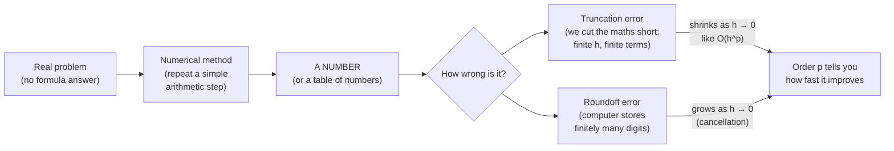
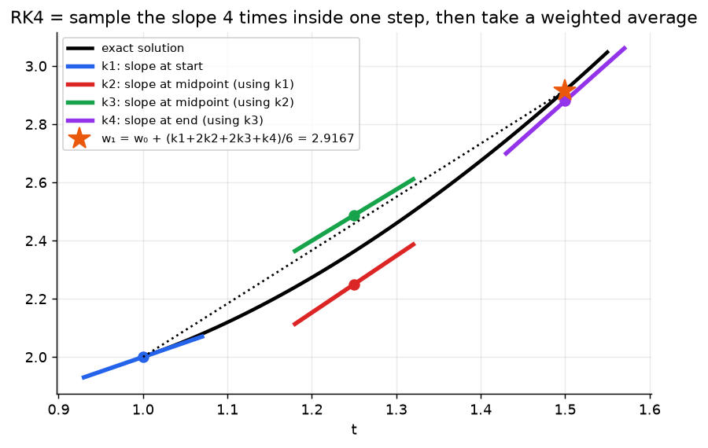
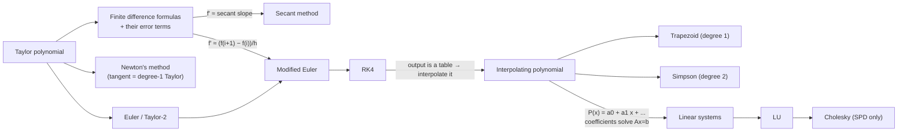
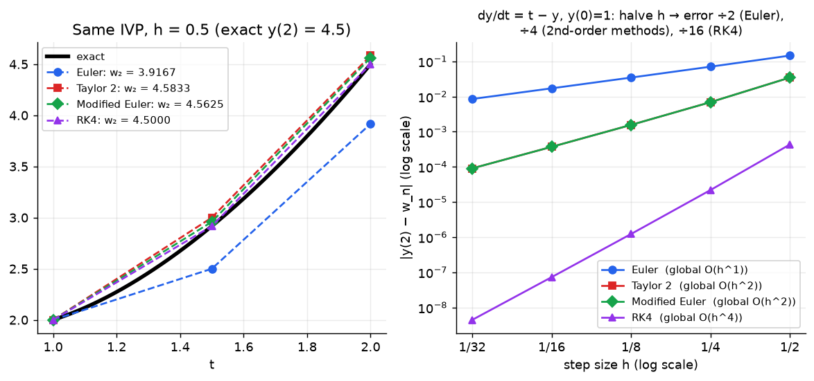
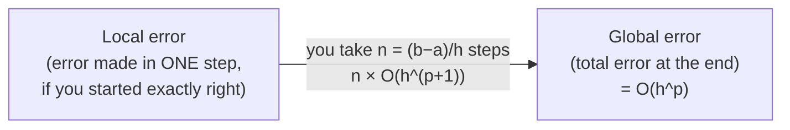

# The Big Picture: what is each method REALLY doing?

> You said you can do the computations but don't see the point. This file is about the point. For every method it answers: **What problem? What goes in? What comes out? What is it secretly doing? Why not just use algebra?**

---

## 0. Why does this unit exist at all?

Most real problems have **no formula answer**:

| Problem | Example | Can algebra solve it? |
|---|---|---|
| Solve an equation | $x = \cos x$ | ❌ no closed form |
| Solve an ODE | SIR epidemic model $S' = -\beta SI,\ \dots$ | ❌ no closed form |
| Integrate | $\int_0^1 e^{-x^2}\,dx$ | ❌ no elementary antiderivative |
| Differentiate | velocity from GPS position *data* | ❌ there's no formula, only a table |
| Fill in data | population in 2005 when you only have 2000 and 2010 | ❌ no formula, only points |
| Solve $Ax=b$ | $1000\times1000$ system | ✅ in theory, but by hand? never |

So every method in this unit does the same thing: **it trades an exact answer you can't get for an approximate number you can get, and comes with a way to know how wrong that number is.**

That last part (error, order, $O(h^p)$, remainder terms, bounds) is why the exam keeps asking "which is more accurate and why?". An approximation is useless unless you know how good it is.

---

## 1. A key correction: what RK4 (and every ODE method) actually gives you

> ❓ *"RK4 is used to find the function"*: not quite, and this is the most important idea in Topic 2.

An ODE $\frac{dy}{dt} = f(t,y),\ y(a)=\alpha$ tells you **the slope of the unknown curve at every point** $(t, y)$. It doesn't tell you the curve itself.

Euler, Taylor 2, Modified Euler and RK4 **never produce a formula for $y(t)$**. They produce a **table of numbers**:

| $t$ | $t_0=a$ | $t_1=a+h$ | $t_2=a+2h$ | ⋯ | $t_n=b$ |
|---|---|---|---|---|---|
| $w \approx y(t)$ | $\alpha$ | $w_1$ | $w_2$ | ⋯ | $w_n$ |

**What they're secretly doing:** you're standing at a known point $(t_i, w_i)$. The ODE tells you which direction the curve is heading (the slope $f(t_i,w_i)$). You walk in that direction for a small time step $h$ and land at $(t_{i+1}, w_{i+1})$. Then you repeat.

- **Euler** checks the slope **once** (at the start) and walks straight. It's cheap and crude, global error $O(h)$.
- **Modified Euler** takes a trial Euler step, checks the slope where it lands, and **averages** the start and end slopes. Global error $O(h^2)$.
- **RK4** checks the slope **4 times** (start, midpoint twice, end) and takes a weighted average $\frac{1}{6}(1,2,2,1)$. Global error $O(h^4)$.

All of them answer the same question: **"what number should $y$ be at the next time?"** The only difference is how cleverly they estimate the average slope over the step.

If you want $y$ at a time that isn't in the table, you **interpolate** (Topic 3). That's one way the topics link together.

---

## 2. Method cards (the whole unit, one card each)

> Format: **Problem → Input → Output → What it's secretly doing → Accuracy → Real use**

### Topic 1: Preliminaries

#### Floating point system $F(\beta,k,m,M)$
- **Problem:** computers can't store every real number.
- **Secretly:** scientific notation with a **fixed number of digits $k$** and a **limited exponent range $[m, M]$**. Anything else gets **rounded** to the nearest representable number.
- **Key numbers:** smallest positive $= \beta^m$; unit roundoff $u = \tfrac12\beta^{1-k}$, the **worst relative error from one rounding**.
- **Why you care:** every method below runs in floating point, so every answer carries roundoff of size about $u$.

#### Catastrophic cancellation
- **Problem:** subtracting two nearly-equal numbers that have already been rounded.
- **Secretly:** the leading digits cancel, and the digits left over are mostly the **rounding noise**. Relative error explodes.
- **Fix:** rearrange the formula algebraically so that no such subtraction happens.
- **Shows up later:** finite differences with tiny $h$ (Week 10) fail for exactly this reason.

#### Taylor polynomial $P_n(x)$ + remainder $R_n(x)$
- **Problem:** replace a hard function with a polynomial near a point $x_0$.
- **Input:** $f$ and its derivatives at **one point** $x_0$.
- **Output:** a polynomial matching $f, f', \dots, f^{(n)}$ at $x_0$, plus a **bound on the error**.
- **Secretly:** if you know where you are, which way you're heading, how fast you're turning, and so on, you can predict nearby values.
- **This is the master tool.** It generates Euler, Taylor 2, Newton's method and every finite-difference formula.

### Topic 2: ODEs (initial value problems)

| Method | Slope samples per step | Needs $f'$? | Global error | One-line meaning |
|---|---|---|---|---|
| Euler | 1 | no | $O(h)$ | walk along the tangent |
| 2nd-order Taylor | 1 (+ derivative) | **yes** | $O(h^2)$ | tangent + curvature correction |
| Modified Euler | 2 | no | $O(h^2)$ | average of start and end slopes |
| RK4 | 4 | no | $O(h^4)$ | weighted average of 4 slopes |

- **Input:** $f(t,y)$, $a$, $b$, $\alpha$, $h$ (or $n$).
- **Output:** the table $w_0, w_1, \dots, w_n$ approximating $y(t_0), \dots, y(t_n)$.
- **Real use:** epidemics (SIR), population models, orbits, circuits, drug release.

### Topic 3: Interpolation

All three forms build **the same unique polynomial** of degree $\le n$ through $n+1$ points. They're just different ways of writing it down.

| Form | Best when | Secretly |
|---|---|---|
| Lagrange | theory, error bounds, quick formula | each basis $L_{n,i}$ "switches on" exactly one data point (1 there, 0 at the others) |
| Newton divided difference | data **not** equally spaced; **adding points later** | builds the polynomial one term at a time, keeping old work |
| Newton forward difference | data **equally spaced** | same as divided differences, with $h$ factored out using $s=(x-x_0)/h$ |

- **Input:** data points $(x_i, y_i)$ from an experiment, a table, or an expensive function.
- **Output:** a polynomial $P_n(x)$ you can **evaluate anywhere** (and differentiate or integrate).
- **Warning:** reliable **between** the data points (interpolation), unreliable **outside** them (extrapolation).

### Topic 4: Roots of nonlinear functions, solve $f(x)=0$

| Method | Needs | Speed | Guaranteed? | Secretly |
|---|---|---|---|---|
| Bisection | bracket $[a,b]$ with sign change | slow (error halves each step) | ✅ yes | "higher or lower?" guessing game |
| Fixed point | rewrite $x = g(x)$ | linear (×λ each step) | only if $\lvert g'\rvert<1$ | feed the output back in as the input |
| Newton | $f'$, one guess | **quadratic** (digits double) | ❌ no | follow the tangent line to zero |
| Secant | two guesses, no $f'$ | order 1.618 | ❌ no | Newton with $f'$ replaced by a secant slope |

- **Output:** a single number $x^*$ with $f(x^*) \approx 0$.
- **Real use:** water depth for a given volume, time for an object to hit the ground, time for 80% of a drug to release (all lecture problems).

### Topic 5: Numerical calculus

#### Finite differences (differentiation)
- **Input:** $f$ values at points spaced $h$ apart (a **table** or a black box).
- **Output:** a number approximating $f'(x_0)$ or $f''(x_0)$.
- **Secretly:** the slope of a **secant line** through nearby points stands in for the tangent slope.
- **Catch:** $h$ too big gives truncation error; $h$ too small gives roundoff (catastrophic cancellation).

#### Quadrature (integration)
- **Input:** $f$ values at $n+1$ equally-spaced points.
- **Output:** a number approximating $\int_a^b f\,dx$.
- **Secretly:** replace $f$ by an interpolating polynomial on each strip and integrate *that* exactly. Trapezoid uses straight lines, $O(h^2)$. Simpson uses parabolas, $O(h^4)$.
- **Every quadrature rule is a weighted sum** $\sum w_i f(x_i)$: Trapezoid weights are $\frac h2(1,2,2,\dots,2,1)$ and Simpson weights are $\frac h3(1,4,2,4,\dots,4,1)$.

### Topic 6: Linear systems $Ax = b$

| Method | Matrix needed | Secretly |
|---|---|---|
| Forward substitution | lower triangular | solve row 1 for $x_1$, plug into row 2, … |
| Backward substitution | upper triangular | solve the last row first, work upwards |
| LU (Doolittle) | any (no pivoting in this unit) | write $A$ = (lower) × (upper), then do 2 easy triangular solves |
| Cholesky | **symmetric positive definite** | $A = LL^T$: half the work of LU, always stable |

- **Why factorise?** Many problems need **the same $A$ with many different $b$'s**. Factorise once (expensive), then each new $b$ costs only two cheap triangular solves.

---

## 3. How the topics feed each other

---

## 4. The one idea behind "order of accuracy"

When an error is $O(h^p)$, **halving $h$ divides the error by $2^p$**:

| Order $p$ | Halve $h$ → error divided by | Examples |
|---|---|---|
| 1 | 2 | Euler, forward/backward difference |
| 2 | 4 | Taylor 2, Modified Euler, central differences, Trapezoid |
| 4 | 16 | RK4, Simpson |

Template answer for **"Which do you expect to be more accurate? Justify."** (1–2 marks every year):

> "(b) should be more accurate, because [method b] is a **second-order** method (global error $O(h^2)$) whereas [method a] is only **first-order** ($O(h)$). For the same $h<1$, $h^2 < h$, so the error in (b) is smaller."

---

## 5. Local vs global error

You lose one power of $h$ because you take about $1/h$ steps. That's why Euler is local $O(h^2)$ but global $O(h)$, and why "order" always refers to the **global** error.
