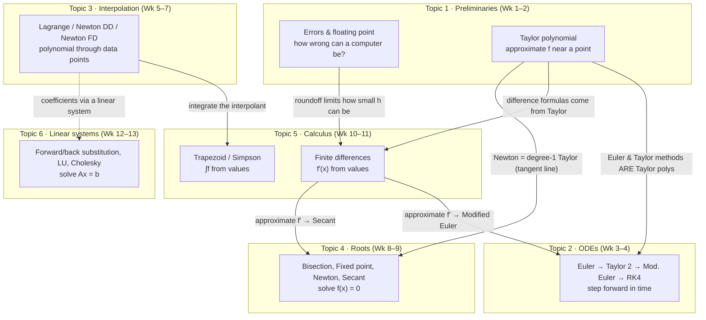

# MXB103 Revision Notes — START HERE

> Built from your Canvas export: all 13 weeks of slides (including Elliot's annotated ones), the lecture problems and solutions, and the **2023, 2024 and 2025 exams with solutions**. Every number in these notes was re-checked with a script.

## How to read these notes

| File | What it's for | When to use it |
|---|---|---|
| [00_big_picture_methods.md](00_big_picture_methods.md) | **What each method is REALLY doing**: input → output → why you'd ever want it | Read first. This is the "why" you said was missing. |
| [week01_errors_floating_point.md](week01_errors_floating_point.md) | Absolute/relative error, binary, floating point systems, unit roundoff | Exam Q1 |
| [week02_cancellation_taylor.md](week02_cancellation_taylor.md) | Catastrophic cancellation, Taylor polynomials, error bounds | Exam Q1(b), Q2 |
| [week03_odes_euler.md](week03_odes_euler.md) | IVPs, what a "numerical solution" is, Euler's method, local/global error | Exam Q3, Q5 |
| [week04_higher_order_ode_methods.md](week04_higher_order_ode_methods.md) | 2nd-order Taylor, Modified Euler, RK4 | Exam Q3, Q4, Q5 |
| [week05_interpolation_lagrange.md](week05_interpolation_lagrange.md) | Interpolation, Lagrange form, remainder bound | Exam Q6 |
| [week06_newton_divided_differences.md](week06_newton_divided_differences.md) | Newton divided difference form | Exam Q8 |
| [week07_newton_forward_differences.md](week07_newton_forward_differences.md) | Newton forward difference form, extrapolation danger | Exam Q7, Q8 |
| [week08_bisection_fixed_point.md](week08_bisection_fixed_point.md) | Root finding: bisection, fixed point iteration | Exam Q9, Q10 |
| [week09_newton_secant.md](week09_newton_secant.md) | Newton's method, secant method, convergence rates | Exam Q9, Q10, Q11 |
| [week10_numerical_differentiation.md](week10_numerical_differentiation.md) | Forward/backward/central differences, choice of h | Exam Q11, Q12 |
| [week11_numerical_integration.md](week11_numerical_integration.md) | Trapezoidal and Simpson's rules | Exam Q13, Q14 |
| [week12_lu_factorisation.md](week12_lu_factorisation.md) | Triangular systems, LU factorisation | Exam Q15 |
| [week13_cholesky.md](week13_cholesky.md) | SPD matrices, Cholesky factorisation | Exam Q16 |
| [formula_sheet.md](formula_sheet.md) · [PDF](formula_sheet.pdf) | **Every formula to memorise**, week by week, each with a short meaning and example. The PDF is typeset with LaTeX for printing; rebuild it after editing the `.md` with `python3 tools/md2tex.py notes/formula_sheet.md notes/formula_sheet.tex && xelatex -output-directory=notes notes/formula_sheet.tex` (run from the repo root) | Memorising, and building your A4 sheet |
| [derivations.pdf](derivations.pdf) | **Every derivation**, step by step: Goal → Idea → numbered Steps (what and why, with exam marks) → Result. ★★★ marks the ones asked in 2023–2025. Source in [derivations_src/](derivations_src/) | Practising derivations from memory |
| [99_exam_playbook.md](99_exam_playbook.md) | Question-by-question exam map, **MATLAB bug catalogue**, derivations to memorise, **errors in the official solutions**, A4 sheet plan | The last 2–3 days |
| [../practice_exams/](../practice_exams/) | **Two full practice exams** with mark-annotated solutions | After the 2023–2025 papers |

Each week file follows the same layout:

1. **The point**: one sentence on why the topic exists
2. **Diagram**: how the pieces connect
3. **Core formulas**: what goes on your A4 sheet
4. **Derivations**: the exam always has 2–4 of these
5. **Worked examples**, set out the way the markers want
6. **Step-by-step walkthroughs**: each method as a numbered table (step / what you do / why), followed by extra examples where every line is labelled with its step
7. **Traps**: where marks are lost
8. **Practice** with hidden answers (click ▶ to reveal)

## Viewing the diagrams

- **PNG figures** (in `img/`) show up in any Markdown viewer.
- **Mermaid diagrams** (the ```` ```mermaid ```` blocks) render on GitHub and Obsidian, and in VS Code once you install the extension **"Markdown Preview Mermaid Support"** (by Matt Bierner). Then open a file and press `Cmd+Shift+V`.
- **Maths** (`$...$`) renders in VS Code's built-in preview.

## The unit in one picture



**Two "mother tools" generate almost everything in this unit:**

- **The Taylor polynomial** (Week 2) gives you Euler, 2nd-order Taylor, Newton's method, and all the finite-difference formulas.
- **The interpolating polynomial** (Weeks 5–7) gives you the Trapezoidal and Simpson's rules.

If you can write down a Taylor expansion and an interpolating polynomial, you can re-derive most of the course in the exam.

## Exam facts (from Canvas)

- 3 hours + 10 min perusal. **80 marks, 16 questions.** Q1–8 are Qianqian's half (Topics 1–3) and Q9–16 are Elliot's half (Topics 4–6).
- **3 questions are "find 3 errors in this MATLAB code and fix them"** (6 marks each, 18 marks total, so learn the bug catalogue).
- Any calculator. **One A4 sheet**, which can be double-sided.
- You do 1–2 iterations by hand, never long computations.
- "Derive", "compare", "which is more accurate and why" are all examinable.
- The layout has been nearly **identical for three years**. See the map in [99_exam_playbook.md](99_exam_playbook.md).

> ⚠️ Calculator: **RADIAN mode**, and **log means ln** (natural log) in this unit.
