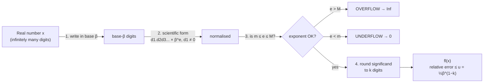
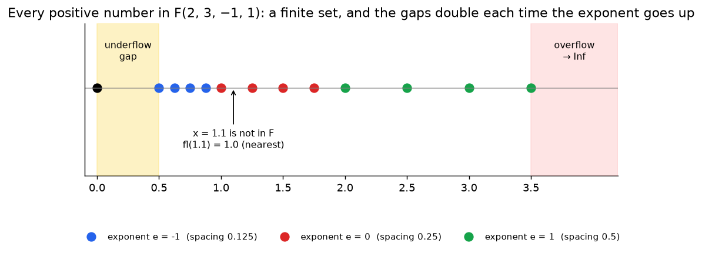

# Week 1: Errors & Floating Point Arithmetic

> **The point:** a computer stores only a **finite** set of numbers, so almost every number gets **rounded**. This week gives you the language to measure that error (absolute and relative) and the formulas for how bad rounding can get (unit roundoff).

**Exam link:** Q1 (2–4 marks): binary ↔ decimal, smallest/largest number, unit roundoff, fl(x).

---

## 1. Absolute and relative error

If $\tilde x$ approximates the true value $x$:

$$\text{absolute error} = |x - \tilde x| \qquad \text{relative error} = \frac{|x-\tilde x|}{|x|}\ (x\neq 0)$$

**Why both?** Absolute error depends on the **size** of the numbers, while relative error measures the **number of correct digits**.

| | $x$ | $\tilde x$ | abs. error | rel. error |
|---|---|---|---|---|
| (a) | $4.0$ | $4.1$ | $0.1$ | $0.025$ |
| (b) | $4.0\times10^{-3}$ | $4.1\times10^{-3}$ | $10^{-4}$ | $0.025$ |

In (b) the absolute error looks tiny, but both approximations are equally good (about 1 correct digit). **Relative error tells the truth.**

> ⚠️ **Exam trap (MATLAB):** relative error divides by the **true** value: `abs(approx - exact)/abs(exact)`. Dividing by the approximation, or forgetting `abs` on the denominator, has been one of the "3 errors" twice (2023 Q6, 2025 Q6).

---

## 2. Binary ↔ decimal

**Binary → decimal:** each digit is multiplied by its power of 2.

$$10001.001_2 = 1\cdot2^4 + 0 + 0 + 0 + 1\cdot2^0 + 0\cdot2^{-1} + 0\cdot2^{-2} + 1\cdot2^{-3} = 16 + 1 + 0.125 = \boxed{17.125}\quad\text{(2024 Q1a)}$$

**Decimal → binary:**
- **Integer part:** divide by 2 repeatedly and read the remainders **bottom-up**.
- **Fractional part:** multiply by 2 repeatedly and read the integer parts **top-down**.

Example: $24.25$ (2023 Q1a)

| integer part 24 | quotient | remainder |
|---|---|---|
| 24 ÷ 2 | 12 | 0 |
| 12 ÷ 2 | 6 | 0 |
| 6 ÷ 2 | 3 | 0 |
| 3 ÷ 2 | 1 | 1 |
| 1 ÷ 2 | 0 | 1 ↑ read upwards: **11000** |

| fraction 0.25 | ×2 | integer part |
|---|---|---|
| 0.25 × 2 | 0.5 | 0 |
| 0.5 × 2 | 1.0 | 1 ↓ read downwards: **.01** |

$$24.25 = \boxed{11000.01_2}$$

Check it: $16+8+0.25 = 24.25$ ✓. Writing the expansion out as a check also earns the "working" mark.

> 💡 $0.1_{10} = 0.000110011001\ldots_2$ **never terminates**. That's why `0.1 + 0.2 ~= 0.3` in MATLAB: 0.1 can't be stored exactly.

---

## 3. Floating point systems $F(\beta, k, m, M)$

$$f = \pm\, d_1.d_2d_3\cdots d_k \times \beta^{e}, \qquad m \le e \le M,\quad d_1 \ne 0 \text{ (unless } f=0)$$

| Symbol | Meaning |
|---|---|
| $\beta$ | base (2 = binary, 10 = decimal) |
| $k$ | number of digits in the significand (**including** the one before the point) |
| $m$ | minimum exponent |
| $M$ | maximum exponent |

The set is **finite** and **not equally spaced**: the gaps get bigger as the numbers get bigger.

### The four formulas to memorise

| Quantity | Formula | Why |
|---|---|---|
| **Smallest positive** | $S = 1.00\cdots0 \times \beta^{m} = \beta^{m}$ | smallest significand (1.000…), smallest exponent |
| **Largest** | $L = (\beta-1).(\beta-1)\cdots(\beta-1)\times\beta^M = (\beta - \beta^{1-k})\,\beta^{M}$ | all digits as large as possible |
| **Unit roundoff** | $u = \tfrac12\,\beta^{1-k}$ | max relative error of rounding: $\frac{\lvert x - fl(x)\rvert}{\lvert x\rvert}\le u$ |
| **IEEE double** | $F(2,53,-1022,1023)$: $u \approx 1.11\times10^{-16}$, $L\approx1.80\times10^{308}$, $S\approx 2.23\times10^{-308}$ | what MATLAB uses |

**Past exam answers:**

| Exam | Question | Answer |
|---|---|---|
| 2025 Q1a | smallest positive in $F(2,5,-4,4)$ | $1.0000_2\times2^{-4} = 2^{-4} = 0.0625$ |
| 2023 Q1b | smallest positive in $F(2,4,-3,4)$ | $1.000_2 \times 2^{-3} = 2^{-3} = 0.125$ |
| 2024 Q1b | unit roundoff of $F(3,6,-7,8)$ | $u=\tfrac12\cdot3^{1-6} = \tfrac12\cdot3^{-5} = 0.0021$ |

> Note: $S$ depends only on $\beta$ and $m$, and $u$ depends only on $\beta$ and $k$. Don't mix them up.

### Rounding a number into $F$: the 4-step procedure (lecture layout)

**Example:** $x = 13.125$ in **(a)** $F(10,2,-1,1)$ and **(b)** $F(2,5,-4,4)$.

**(a)**
1. Base 10: $x = 13.125$
2. Scientific form: $x = 1.3125\times10^{1}$
3. Exponent $e=1$ satisfies $-1\le e\le1$ ✓
4. Round to $k=2$ digits: $fl(x) = 1.3\times10^{1} = 13$

**(b)**
1. Base 2: $13.125 = 1101.001_2$
2. Scientific form: $1.101001_2 \times 2^3$
3. $e=3$ satisfies $-4\le3\le4$ ✓
4. Round to $k=5$ digits: $1.1010|01 \to 1.1010_2\times2^3 = 1101.0_2 = 13$

---

## 4. Overflow & underflow

- **Overflow:** $|x| >$ largest number (exponent too big) → `Inf`, or the program stops.
- **Underflow:** $|x| <$ smallest positive number (exponent too small) → replaced by `0`.

e.g. in $F(10,2,-1,1)$: $fl(100)$ = **Inf** (overflow), $fl(0.04)$ = **0** (underflow).

---

## 5. Deriving the IEEE double values (lecture example)

- $u = \tfrac12\cdot2^{1-53} = 2^{-53} \approx 1.11\times10^{-16}$
- $S = 1.0\cdots0_2\times2^{-1022} = 2^{-1022}\approx 2.23\times10^{-308}$
- $L = 1.11\cdots1_2\times2^{1023} = (2-2^{-52})\times2^{1023}\approx1.80\times10^{308}$, using the geometric series $1 + \tfrac12 + \cdots + 2^{-52} = 2 - 2^{-52}$

---

## Step-by-step: what each step is doing

### Procedure A: decimal → binary

| Step | What you do | Why |
|---|---|---|
| 1 | Split $x$ into its integer part and its fraction | They are converted by different rules |
| 2 | Integer: divide by 2 repeatedly, recording remainders | Each remainder is the next binary digit, starting from the $2^0$ place |
| 3 | Read the remainders **bottom-up** | The last remainder belongs to the highest power of 2 |
| 4 | Fraction: multiply by 2 repeatedly, recording the integer part (0 or 1) | Doubling shifts the binary point right; the digit that crosses it is the next digit, starting from the $2^{-1}$ place |
| 5 | Read the integer parts **top-down**; stop when the fraction is 0 | The first digit produced is the $2^{-1}$ digit |
| 6 | Check by expanding powers of 2 | This catches slips and earns the working mark |

### Procedure B: find $fl(x)$ in $F(\beta,k,m,M)$

| Step | What you do | Why |
|---|---|---|
| 1 | Write $x$ in base $\beta$ | The machine stores base-$\beta$ digits |
| 2 | Normalise to $d_1.d_2d_3\ldots\times\beta^e$ with $d_1\neq0$ | This is the unique representation the system uses |
| 3 | Check $m\le e\le M$ | $e>M$ overflows (→ Inf); $e<m$ underflows (→ 0) |
| 4 | Round the significand to $k$ digits | Only $k$ digits can be stored, and rounding causes the error |
| 5 | (Optional) relative error $\frac{\lvert x-fl(x)\rvert}{\lvert x\rvert}$ | It is always $\le u=\frac12\beta^{1-k}$ |

### Worked example A: $fl(10.375)$ in $F(2,4,-3,3)$

- **Step 1 (to binary):** $10=1010_2$. Fraction: $0.375\times2=0.75\to0$, $0.75\times2=1.5\to1$, $0.5\times2=1.0\to1$, giving $.011$. So $10.375=1010.011_2$.
- **Step 2 (normalise):** move the point 3 places left: $1.010011_2\times2^3$.
- **Step 3 (exponent check):** $e=3$, and $-3\le3\le3$ ✓, so there is no overflow.
- **Step 4 (round to $k=4$ digits):** $1.010\,|\,011$. The first dropped digit is 0, so round down: $fl(x)=1.010_2\times2^3=1010_2=\mathbf{10}$.
- **Step 5 (error):** relative error $=\frac{0.375}{10.375}=0.0361\le u=\frac12\cdot2^{-3}=0.0625$ ✓

### Worked example B: overflow and underflow in $F(10,3,-2,2)$

- $x=456.78$: normalise to $4.5678\times10^2$. $e=2\le M$ ✓. Round to 3 digits: $fl(x)=4.57\times10^2=\mathbf{457}$.
- $x=0.0012345$: normalise to $1.2345\times10^{-3}$. $e=-3<m=-2$, so **underflow**: $fl(x)=0$.
- $x=1234$: $1.234\times10^3$. $e=3>M=2$, so **overflow**: $fl(x)=$ Inf.

### Worked example C: all three key numbers for $F(3,3,-2,2)$

- **Smallest positive** (smallest significand $1.00_3$, smallest exponent): $S=1.00_3\times3^{-2}=\frac19=\mathbf{0.1111}$
- **Largest** (every digit $\beta-1=2$, largest exponent): $L=2.22_3\times3^2=\left(2+\tfrac23+\tfrac29\right)\times9=\mathbf{26}$. Formula check: $(3-3^{-2})\cdot9=27-1=26$ ✓
- **Unit roundoff:** $u=\frac12\cdot3^{1-3}=\frac1{18}=\mathbf{0.0556}$

---

## Traps

- $k$ counts **all** significand digits, including $d_1$. So $F(2,5,\dots)$ means $1.xxxx$ (four digits after the point).
- The smallest positive number has $d_1 = 1$, **not** 0 (normalised).
- Always write the expansion ($1\times2^4 + \dots$) to get the working mark.
- Calculator: "log" means **ln** in this unit.

---

## Practice

**P1.** Convert $1101.011_2$ to decimal.

Answer

$8+4+0+1+0+0.25+0.125 = 13.375$

**P2.** Convert $6.375$ to binary.

Answer

$6 = 110_2$. For the fraction: $0.375\times2=0.75\to0$, $0.75\times2=1.5\to1$, $0.5\times2=1.0\to1$, giving $.011$. So $6.375 = 110.011_2$.

**P3.** For $F(10,3,-1,2)$ find $u$, the smallest positive number and the largest number. Then find $fl(123.4)$, $fl(1234)$, $fl(-17.953)$, $fl(\pi)$.

Answer

$u=\tfrac12\cdot10^{-2}=0.005$. Smallest $=1.00\times10^{-1}=0.1$. Largest $=9.99\times10^{2}=999$.

- $fl(123.4)=1.23\times10^2$ (relative error $0.4/123.4 = 0.0032 \le u$ ✓)
- $fl(1234)$: $1.234\times10^3$ has $e=3>2$, so **overflow**
- $fl(-17.953) = -1.80\times10^1$
- $fl(\pi)=3.14\times10^0$

**P4.** For $F(2,5,-4,4)$ find $u$ and the largest representable number.

Answer

$u = \tfrac12\cdot2^{-4} = 0.03125$. Largest $=1.1111_2\times2^4 = 11111_2 = 31$.

