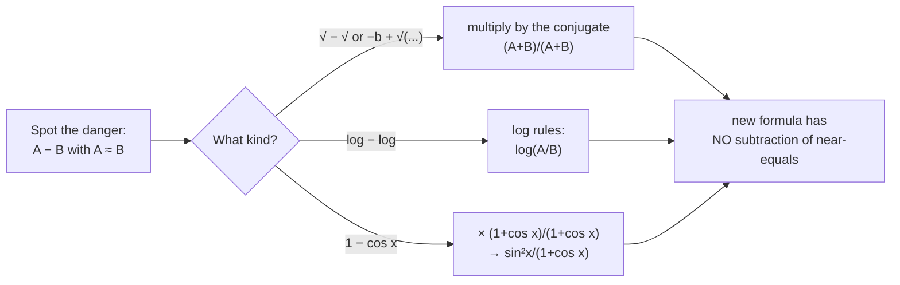
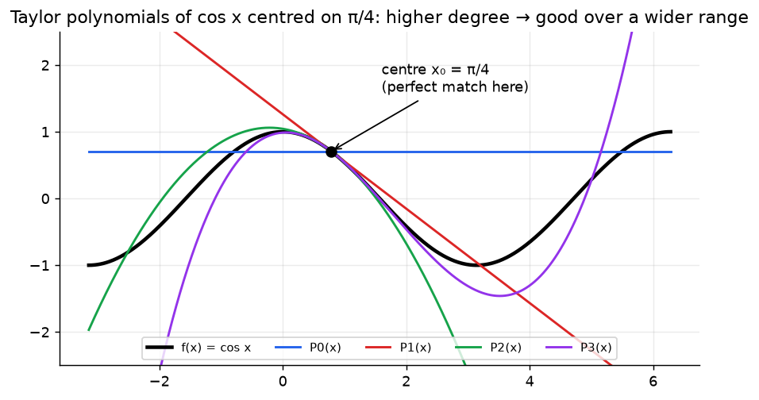
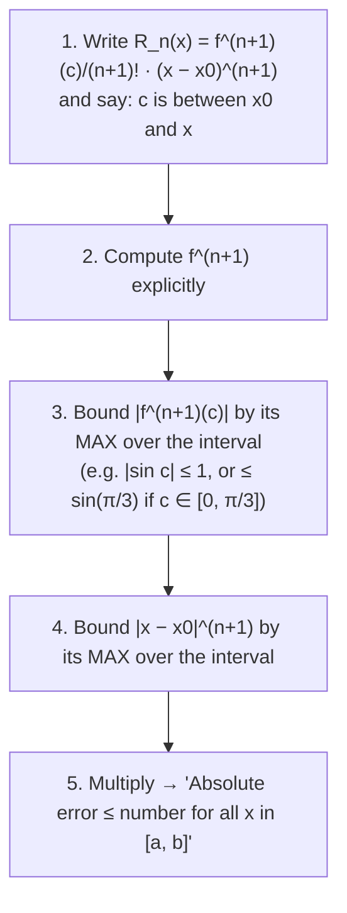

# Week 2: Catastrophic Cancellation & Taylor Polynomials

> **The point:**
> 1. One operation, **subtracting nearly-equal rounded numbers**, can destroy all your accuracy. You fix it by rearranging the formula.
> 2. The **Taylor polynomial** replaces a hard function with a polynomial near a point, and the **remainder term** tells you exactly how wrong that is. This is the **master tool** for Weeks 3, 4, 9 and 10.

**Exam link:** Q1(b) (3 marks): rearrange a formula to avoid cancellation. Q2 (6 marks): find a Taylor polynomial, then bound its error.

---

## Part A: Catastrophic cancellation

**Definition:** the error that happens when you subtract two numbers that are **almost equal**, where at least one is **not exactly represented**.

**Why it's catastrophic:** both numbers carry a tiny rounding error. Subtraction cancels the correct leading digits, so what's left is mostly error.

### Lecture example ($3$-digit arithmetic)
$x=3.34,\ y=2.44,\ z=4.56$. Compute $x^2 - yz$.

| | exact | rounded to 3 digits |
|---|---|---|
| $x^2$ | $11.1556$ | $11.2$ |
| $yz$ | $11.1264$ | $11.1$ |
| $x^2-yz$ | $0.0292$ | $11.2-11.1 = 0.1$ |

Relative error $=\frac{|0.0292-0.1|}{0.0292} = 2.42$, i.e. **242%, with zero correct digits**, from one subtraction.

> **Benign cancellation:** subtracting nearly-equal numbers that are **exactly represented** is harmless. The danger comes only from the rounding *before* the subtraction.

### The fix: rearrange algebraically

| Expression | Dangerous when | Safe rearrangement |
|---|---|---|
| $\dfrac{-b+\sqrt{b^2-4ac}}{2a}$ | $b^2\gg4ac$, $b>0$ | $\dfrac{-2c}{b+\sqrt{b^2-4ac}}$ |
| $\dfrac{-b-\sqrt{b^2-4ac}}{2a}$ | $b^2\gg4ac$, $b<0$ | $\dfrac{-2c}{b-\sqrt{b^2-4ac}}$ (or use $x_1x_2=c/a$) |
| $1-\cos x$ | $x\approx0$ | $\dfrac{\sin^2x}{1+\cos x}$ |
| $\log(x+1)-\log x$ | $x$ large | $\log\!\left(1+\tfrac1x\right)$ |
| $\sqrt{x+1}-\sqrt{x}$ | $x$ large | $\dfrac{1}{\sqrt{x+1}+\sqrt x}$ |

### Exam answer layout (2025 Q1b, 3 marks)

> **[1 mark: recognise the situation]** When $b^2\gg4ac$, $\sqrt{b^2-4ac}\approx|b|$, so the numerator is approximately $-b+|b|$. When $b>0$ this subtracts two nearly-equal numbers, which is catastrophic cancellation.
>
> **[1 mark: working]**
> $$x=\frac{-b+\sqrt{b^2-4ac}}{2a}\cdot\frac{-b-\sqrt{b^2-4ac}}{-b-\sqrt{b^2-4ac}} = \frac{b^2-(b^2-4ac)}{-2a\,(b+\sqrt{b^2-4ac})}$$
>
> **[1 mark: answer]**
> $$x = \frac{4ac}{-2a(b+\sqrt{b^2-4ac})} = \frac{-2c}{b+\sqrt{b^2-4ac}}$$

Now the denominator **adds** two positive numbers of similar size, so there's no cancellation.

---

## Part B: Taylor polynomials

### Definition
The Taylor polynomial of degree $n$ for $f$, centred on $x_0$:

$$P_n(x) = f(x_0) + f'(x_0)(x-x_0) + \frac{f''(x_0)}{2!}(x-x_0)^2 + \cdots + \frac{f^{(n)}(x_0)}{n!}(x-x_0)^n = \sum_{k=0}^{n}\frac{f^{(k)}(x_0)}{k!}(x-x_0)^k$$

It is the unique degree-$n$ polynomial that matches $f$ **and its first $n$ derivatives** at $x_0$.

### Taylor's theorem (the error)
$$f(x) = P_n(x) + R_n(x),\qquad R_n(x) = \frac{f^{(n+1)}(c)}{(n+1)!}(x-x_0)^{n+1}$$
for some (unknown) $c$ **between $x_0$ and $x$**.

So the **absolute error** is $|f(x)-P_n(x)| = |R_n(x)|$. You don't know $c$, so you **bound** it by taking the worst case.

### Recipe for the error-bound question (3 marks)

### Worked: 2025 Q2 ($f=\cos x$, degree 2, $x_0=0$, $x\in[0,\pi/3]$)

**(a)** $f(0)=1,\ f'(x)=-\sin x\Rightarrow f'(0)=0,\ f''(x)=-\cos x\Rightarrow f''(0)=-1$
$$P_2(x) = 1 + 0\cdot x - \tfrac12x^2 = 1-\tfrac{x^2}{2}$$

**(b)** $f'''(x)=\sin x$, so $R_2(x)=\dfrac{\sin c}{3!}x^3$ with $c$ between $0$ and $x$, hence $c\in[0,\pi/3]$.
$$|R_2(x)| = \tfrac16|\sin c|\,|x|^3 \le \tfrac16\cdot\tfrac{\sqrt3}{2}\cdot\left(\tfrac{\pi}{3}\right)^3 = \boxed{0.1658}$$
(Using $|\sin c|\le1$ gives $0.1914$. That is also a valid upper bound, just less tight.)

### Other past-exam versions (same recipe)

| Exam | Setup | $P_n$ | Error bound |
|---|---|---|---|
| 2024 Q2 | $\sin x$, $n=3$, $x_0=0$, $[0,\pi/2]$ | $x-\dfrac{x^3}{6}$ | $R_3=\dfrac{\sin c}{24}x^4$, so $\le 1\cdot\dfrac{(\pi/2)^4}{24}=\dfrac{\pi^4}{384}=0.2537$ |
| 2023 Q2 | $\sin x$, $n=1$, $x_0=\pi/6$, $[0,\pi/3]$ | $\tfrac12+\tfrac{\sqrt3}{2}\left(x-\tfrac\pi6\right)$ | $R_1=\dfrac{-\sin c}{2}(x-\tfrac\pi6)^2$, so $\le\tfrac12\cdot\dfrac{\pi^2}{36}=\dfrac{\pi^2}{72}=0.1371$ |
| Lecture | $\cos x$, $n=2$, $x_0=\pi/4$, $[0,\pi/2]$ | $\tfrac{\sqrt2}{2}-\tfrac{\sqrt2}{2}(x-\tfrac\pi4)-\tfrac{\sqrt2}{4}(x-\tfrac\pi4)^2$ | $\le\tfrac16\left(\tfrac\pi4\right)^3=0.0807$ |

### Truncation error
$e^x = 1+x+\frac{x^2}{2!}+\cdots$ exactly, as an **infinite** sum. A computer must stop somewhere, and the error from cutting the sum off is **truncation error**. The remainder $R_n$ measures it.

> **Two error sources in this unit:** **truncation** (from cutting the maths short: finite $n$, finite $h$) and **roundoff** (from storing finitely many digits). Week 10 shows them fighting each other.

---

## Traps

- **Radian mode!** $\cos(\pi/4)$, not $\cos(45)$.
- $R_n$ uses the $(n+1)$th derivative at $c$, **not** at $x_0$.
- State **where $c$ lies**: it earns marks.
- When maximising $|x-x_0|^{n+1}$ over the interval, check **both endpoints**. For $x_0=\pi/6$ on $[0,\pi/3]$ both give $(\pi/6)^2$.
- When finding the max of $|f^{(n+1)}(c)|$, $c$ ranges over the interval, so use the actual max if you can (e.g. $\sin$ is increasing on $[0,\pi/2]$).

---

## Practice

**P1.** Find $P_2$ for $e^x$ centred on $x_0=0$, and bound the error on $[0,0.5]$. Check the bound against the actual error at $x=0.5$.

Answer

$P_2 = 1+x+\tfrac{x^2}{2}$. $R_2=\tfrac{e^c}{6}x^3$ with $c\in[0,0.5]$, so $|R_2|\le\tfrac{e^{0.5}}{6}(0.5)^3 = 0.0343$.

Actual error: $P_2(0.5)=1.625$ and $e^{0.5}=1.6487$, so the error is $0.0237\le0.0343$ ✓

**P2.** Rewrite $\sqrt{x+1}-\sqrt x$ for large $x$.

Answer

Multiply by $\frac{\sqrt{x+1}+\sqrt x}{\sqrt{x+1}+\sqrt x}$ to get $\dfrac{(x+1)-x}{\sqrt{x+1}+\sqrt x}=\dfrac{1}{\sqrt{x+1}+\sqrt x}$.

**P3.** Find the Taylor polynomial of degree $n$ for $e^x$ centred on $x_0=1$, and its remainder (lecture problem).

Answer

Every derivative of $e^x$ at $1$ equals $e$, so $P_n(x)=e\sum_{k=0}^n\frac{(x-1)^k}{k!}$ and $R_n(x)=\frac{e^c}{(n+1)!}(x-1)^{n+1}$, $c$ between $1$ and $x$.

