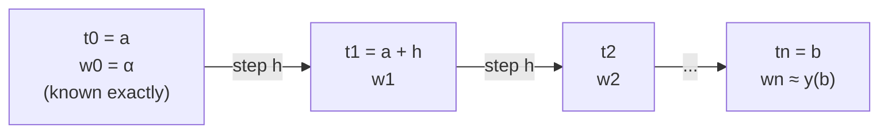
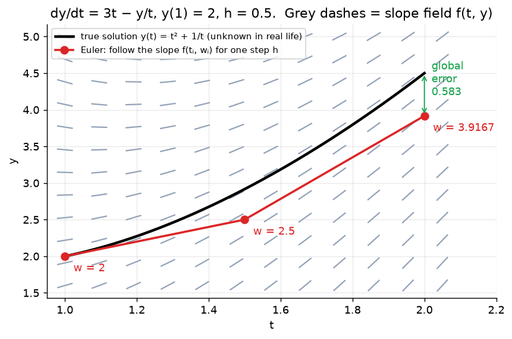

# Week 3: ODEs, Initial Value Problems & Euler's Method

> **The point:** most ODEs (like the SIR epidemic model) have **no formula solution**. An ODE tells you the **slope** of the unknown curve at every point, so you start at the initial condition and **step forward along the slope**, one small step $h$ at a time. The output is a **table of numbers** $w_i\approx y(t_i)$, not a formula.

**Exam link:** Q3(a) (2 marks): one Euler step every year. Q3(c): "which is more accurate?". Q5 (4 marks): derive a method (the Euler derivation is the template for all of them).

---

## 1. The problem (IVP)

$$\frac{dy}{dt}=f(t,y),\quad a\le t\le b,\qquad y(a)=\alpha$$

- $f(t,y)$ is the right-hand side and may depend on **both** $t$ and $y$
- The **initial condition** $y(a)=\alpha$ picks one curve out of the family of solutions $y = Ce^t + \dots$

**Checking a solution** (lecture example): is $y=t^2+\frac1t$ the solution of $y'=3t-\frac yt,\ y(1)=2$?
- LHS: $y' = 2t-\frac1{t^2}$
- RHS: $3t - \frac{t^2+1/t}{t} = 3t - t - \frac{1}{t^2} = 2t-\frac1{t^2}$ ✓
- $y(1)=1+1=2$ ✓, so yes.

**Why we need numerics:** integration, integrating factors and separation of variables only work for **special forms** of $f$. Numerical methods work for **any** $f(t,y)$.

---

## 2. Discretise time

$$h=\frac{b-a}{n},\qquad t_i=a+ih\ \ (i=0,\dots,n),\qquad w_i\approx y_i=y(t_i)$$



These are **one-step methods**: $w_{i+1}$ is computed from $w_i$ only.

---

## 3. Euler's method (= 1st-order Taylor method)

$$\boxed{w_0=\alpha,\qquad w_{i+1}=w_i+h\,f(t_i,w_i),\quad i=0,1,\dots,n-1}$$

**Meaning:** new value = old value + (step) × (slope at the old point). You walk along the **tangent line**.



### Derivation (learn this one: every ODE derivation follows the same 4 moves)

1. **Taylor polynomial of degree 1** for $y(t)$ about $t_i$:
$$y(t) = y(t_i) + y'(t_i)(t-t_i) + \frac{y''(c)}{2}(t-t_i)^2$$
2. **Evaluate at $t=t_{i+1}$**, using $t_{i+1}-t_i=h$:
$$y_{i+1} = y_i + h\,y'(t_i) + O(h^2)$$
3. **Use the ODE** $y'(t_i)=f(t_i,y_i)$:
$$y_{i+1} = y_i + h f(t_i,y_i) + O(h^2)$$
4. **Drop the $O(h^2)$ term and replace $y_i$ with $w_i$:**
$$w_{i+1} = w_i + h f(t_i,w_i)$$

---

## 4. Worked examples (set out like the lectures)

### Lecture: $y'=3t-\dfrac yt$, $y(1)=2$, $h=0.5$ on $[1,2]$ (exact $y=t^2+1/t$)

$f(t,y)=3t-\frac yt$, $a=1$, $b=2$, $\alpha=2$, $n=2$

| $i$ | $t_i$ | $w_i$ | working |
|---|---|---|---|
| 0 | 1 | 2 | initial condition |
| 1 | 1.5 | 2.5 | $w_1 = 2 + 0.5\,f(1,2) = 2+0.5(3-2)$ |
| 2 | 2 | 3.9167 | $w_2 = 2.5+0.5\,f(1.5,2.5)=2.5+0.5(4.5-1.6667)$ |

Exact: $y(1.5)=2.9167$, $y(2)=4.5$. The result is poor because $h$ is large. Smaller $h$ is better, but means more steps (so use MATLAB).

### Past-exam one-steppers

| Exam | IVP, $h$ | Euler $w_1$ |
|---|---|---|
| 2025 Q3a | $y'=1+\frac yt$, $y(1)=1$, $h=0.25$ | $1+0.25(1+1)=\mathbf{1.5}$ ⚠️ official solution says 1.2, which is a typo |
| 2024 Q3a | $y'=3+ty^3$, $y(2)=1$, $h=0.1$ | $1+0.1(3+2)=\mathbf{1.5}$ |
| 2023 Q3a | $y'=2t-y^2$, $y(0)=1$, $h=0.1$ | $1+0.1(0-1)=\mathbf{0.9}$ |

**Mark scheme:** 1 mark for setup (Euler formula, $f$ and $w_0$ written down), 1 mark for the number.

---

## 5. Local vs global error, and "order"

- **Local error:** error made in **one step**, assuming you started exactly right. For Euler, from step 3 above, it is $O(h^2)$.
- **Global error:** $|y_i-w_i|$ after $i$ steps, which accumulates the local errors. For Euler it is $O(h)$.
- **General rule:** local $O(h^{p+1})$ means global $O(h^p)$, because you take $n=(b-a)/h$ steps:
$$n\times O(h^{p+1}) = \frac{b-a}{h}O(h^{p+1}) = O(h^p)$$
- **"Order of the method" = order of the global error.** Euler is **first order**: halve $h$ and the error halves.

---

## 6. Systems of ODEs (SIR model)

$$S'=-\beta SI,\qquad I'=\beta SI-\gamma I,\qquad R'=\gamma I$$

Euler applies to **each component at once**, using the old values on the right-hand side:

$$S_{i+1}=S_i+h(-\beta S_iI_i),\quad I_{i+1}=I_i+h(\beta S_iI_i-\gamma I_i),\quad R_{i+1}=R_i+h\gamma I_i$$

---

## 7. MATLAB template (know it well enough to spot bugs)

```matlab
f = @(t,y) 3*t - y./t;     % RHS of ODE
a = 1; b = 2; n = 2;
h = (b - a)/n;             % NOT (a+b)/n, NOT (b-a)/h
t = a;                     % must initialise t
w = 2;                     % must initialise w = alpha
for i = 1:n
    w = w + h*f(t,w);      % f(t,w), NOT f(w,t)
    t = t + h;             % advance time AFTER using old t
end
```

---

## Traps

- $f(t_i,w_i)$ uses the **current** $t$ and $w$, so update $t$ **after** using it.
- The answer is $w_n$, an **approximation** of $y(b)$. Write "$y(1.25)\approx w_1=\dots$".
- $h$ vs $n$: $n=(b-a)/h$.

---

## Practice

**P1.** $y'=t-y$, $y(0)=1$, $h=0.1$. Find $w_1,w_2$ with Euler. (Exact: $y=t-1+2e^{-t}$.)
<details><summary>Answer</summary>

- $w_1=1+0.1(0-1)=0.9$
- $w_2=0.9+0.1(0.1-0.9)=0.82$

Exact $y(0.2)=0.8375$, so the global error is $0.0175$.
</details>

**P2.** Lecture problem: $y'=1+\frac yt$, $y(1)=1$, $h=0.5$ on $[1,2]$. (Exact: $y=t\ln t+t$.)
<details><summary>Answer</summary>

- $w_1=1+0.5(1+1)=2$
- $w_2=2+0.5\left(1+\frac{2}{1.5}\right)=3.1667$

Exact $y(2)=2\ln2+2=3.3863$.
</details>

**P3.** Why is Euler called "first order" when its local error is $O(h^2)$?
<details><summary>Answer</summary>

"Order" refers to the **global** error. You take $(b-a)/h$ steps, each contributing $O(h^2)$, so the total is $O(h)$, i.e. first order.
</details>
