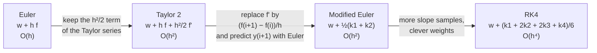
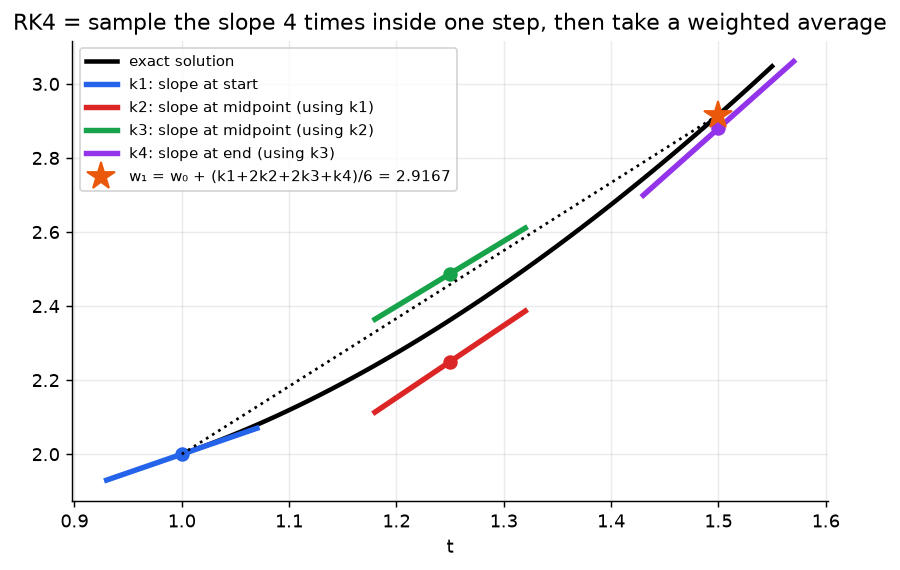
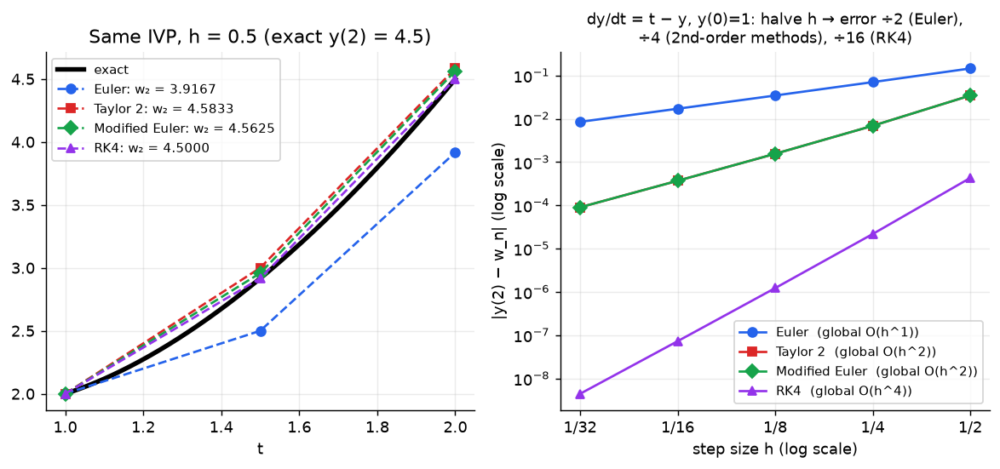

# Week 4: Higher-Order ODE Methods (Taylor 2, Modified Euler, RK4)

> **The point:** Euler's single tangent-line step is crude ($O(h)$). We get much more accuracy **for the same $h$** by estimating the average slope over the step more cleverly:
> - **Taylor 2:** add the curvature term (needs $f'$, so it's annoying)
> - **Modified Euler:** average the slope at the start and at a predicted end point
> - **RK4:** a weighted average of 4 slope samples
>
> All of them still output a **table** $w_0,\dots,w_n$, not a formula.

**Exam link:** Q3(b) (3 marks): one step of Taylor 2 or Modified Euler. Q4 (6 marks): **MATLAB bugs in an ODE solver** (every year). Q5 (4 marks): **derive Taylor 2 or Modified Euler** (every year).

---

## 1. Second-order Taylor method

$$\boxed{w_{i+1}=w_i+h\,f(t_i,w_i)+\frac{h^2}{2}f'(t_i,w_i)}\qquad\text{local }O(h^3),\ \text{global }O(h^2)$$

### ⚠️ The derivative $f'$ is the TOTAL derivative with respect to $t$
$y$ depends on $t$, so use the **chain rule**, and wherever $y'$ appears, replace it with $f$:

$$f'(t,y)=\frac{d}{dt}f(t,y(t))=\frac{\partial f}{\partial t}+\frac{\partial f}{\partial y}\cdot\underbrace{y'}_{=f(t,y)}$$

| $f(t,y)$ | $f'(t,y)$ | source |
|---|---|---|
| $3t-\frac yt$ | $3-\frac{y'}{t}+\frac{y}{t^2}=3-\frac{f}{t}+\frac y{t^2}=\mathbf{\frac{2y}{t^2}}$ | lecture |
| $1+\frac yt$ | $\frac{y'}{t}-\frac{y}{t^2}=\frac{1+y/t}{t}-\frac y{t^2}=\mathbf{\frac1t}$ | 2025 Q3b |
| $4t+y^2$ | $4+2y\cdot\mathbf{f(t,y)}$ | 2023 Q4 (the bug was a missing `*f(t,y)`) |
| $2t\cos y$ | $2\cos y-2t\sin y\cdot\mathbf{f(t,y)}$ | 2024 Q4 (same bug) |
| $t-y$ | $1-y'=1-f=1-t+y$ | practice |

> The 2025 marking scheme says: **"award 0 marks for failing to recognise that $y$ is a function of $t$"**, e.g. writing $f'=-y/t^2$.

### Derivation (2023 Q5, 4 marks): same 4 moves as Euler, one extra term
1. Taylor polynomial of degree 2 for $y(t)$ about $t_i$: $y(t)=y(t_i)+y'(t_i)(t-t_i)+\frac{y''(t_i)}2(t-t_i)^2+O((t-t_i)^3)$  **[1]**
2. Evaluate at $t_{i+1}$: $y_{i+1}=y_i+hy'(t_i)+\frac{h^2}{2}y''(t_i)+O(h^3)$  **[1]**
3. ODE: $y'=f(t,y)$, so $y''=f'(t,y)$, giving $y_{i+1}=y_i+hf(t_i,y_i)+\frac{h^2}2f'(t_i,y_i)+O(h^3)$  **[1]**
4. Drop $O(h^3)$ and replace $y$ with $w$: $w_{i+1}=w_i+hf(t_i,w_i)+\frac{h^2}2f'(t_i,w_i)$  **[1]**

### Worked: 2025 Q3b ($y'=1+\frac yt$, $y(1)=1$, $h=0.25$)
$f(1,1)=2$, $f'(1,1)=\frac11=1$

$$w_1 = 1+0.25(2)+\frac{0.25^2}{2}(1) = 1+0.5+0.03125=\boxed{1.53125}$$

---

## 2. Modified Euler method

$$\boxed{\begin{aligned}k_1&=h\,f(t_i,w_i)\\k_2&=h\,f(t_i+h,\ w_i+k_1)\\w_{i+1}&=w_i+\tfrac12(k_1+k_2)\end{aligned}}\qquad\text{local }O(h^3),\ \text{global }O(h^2)$$

**Meaning:** take a trial Euler step to land at $(t_{i+1},w_i+k_1)$, measure the slope there, then use the **average** of the start and end slopes. It's the same accuracy as Taylor 2 **without needing $f'$**.

### Derivation (2024 Q5 & 2025 Q5, 4 marks): **memorise this one**
1. Start from Taylor 2 (steps 1–3 above): $y_{i+1}=y_i+hf(t_i,y_i)+\frac{h^2}{2}f'(t_i,y_i)+O(h^3)$  **[1.5]**
2. Approximate the derivative with a forward difference: $f'(t_i,y_i)=\dfrac{f(t_{i+1},y_{i+1})-f(t_i,y_i)}{h}+O(h)$  **[0.5]**
3. Substitute and simplify (the $\frac{h^2}{2}\cdot O(h)$ term becomes part of $O(h^3)$):  **[1]**
$$y_{i+1}=y_i+hf_i+\frac h2\left[f(t_{i+1},y_{i+1})-f(t_i,y_i)\right]+O(h^3)=y_i+\frac h2\left[f(t_i,y_i)+f(t_{i+1},y_{i+1})\right]+O(h^3)$$
4. Drop $O(h^3)$ and replace $y$ with $w$: $w_{i+1}=w_i+\frac h2[f(t_i,w_i)+f(t_{i+1},w_{i+1})]$. **Problem:** $w_{i+1}$ appears on both sides. **Fix:** on the right-hand side, use Euler's estimate $w_{i+1}\approx w_i+hf(t_i,w_i)$:  **[1]**
$$w_{i+1}=w_i+\frac h2\Big[f(t_i,w_i)+f\big(t_{i+1},\,w_i+hf(t_i,w_i)\big)\Big]$$

This is exactly $w_i+\frac12(k_1+k_2)$.

### Worked: 2024 Q3b ($y'=3+ty^3$, $y(2)=1$, $h=0.1$)
- $k_1=0.1\,f(2,1)=0.1(3+2)=0.5$
- $k_2=0.1\,f(2.1,\ 1+0.5)=0.1(3+2.1\times1.5^3)=0.1(10.0875)=1.00875$
- $w_1=1+\tfrac12(0.5+1.00875)=\boxed{1.754375}$

### Worked: 2023 Q3b ($y'=2t-y^2$, $y(0)=1$, $h=0.1$)
- $k_1=0.1(0-1)=-0.1$
- $k_2=0.1\,f(0.1,0.9)=0.1(0.2-0.81)=-0.061$
- $w_1=1+\tfrac12(-0.161)=\boxed{0.9195}$

---

## 3. Classical 4th-order Runge–Kutta (RK4)

$$\boxed{\begin{aligned}k_1&=h\,f(t_i,\ w_i)\\k_2&=h\,f\!\left(t_i+\tfrac h2,\ w_i+\tfrac{k_1}2\right)\\k_3&=h\,f\!\left(t_i+\tfrac h2,\ w_i+\tfrac{k_2}2\right)\\k_4&=h\,f(t_i+h,\ w_i+k_3)\quad\leftarrow\text{ full }k_3\text{, not }k_3/2!\\w_{i+1}&=w_i+\tfrac16(k_1+2k_2+2k_3+k_4)\end{aligned}}\qquad\text{local }O(h^5),\ \text{global }O(h^4)$$

**Meaning:** sample the slope at the start ($k_1$), twice at the midpoint ($k_2$, $k_3$, each using the latest guess) and at the end ($k_4$). Weight them $1:2:2:1$ (the middle counts double, like Simpson's rule: $\frac16(1+4+1)$).

### Worked: lecture, $y'=3t-\frac yt$, $y(1)=2$, $h=0.5$ (first step)
- $k_1=0.5\,f(1,2)=0.5$
- $k_2=0.5\,f(1.25,\ 2.25)=0.975$
- $k_3=0.5\,f(1.25,\ 2.4875)=0.88$
- $k_4=0.5\,f(1.5,\ 2.88)=1.29$
- $w_1=2+\tfrac16(0.5+1.95+1.76+1.29)=\boxed{2.9167}$ (exact $2.9167$!)

---

## 4. Comparison (lecture IVP, $h=0.5$, exact $y(2)=4.5$)

| Method | $w_1$ ($t=1.5$) | $w_2$ ($t=2$) | Needs $f'$? | $f$-evaluations per step | Global order |
|---|---|---|---|---|---|
| Euler | 2.5 | 3.9167 | no | 1 | 1 |
| Taylor 2 | 3 | 4.5833 | **yes** | 1 + $f'$ | 2 |
| Modified Euler | 2.9583 | 4.5625 | no | 2 | 2 |
| RK4 | 2.9167 | 4.5000 | no | 4 | 4 |
| exact | 2.9167 | 4.5 | | | |

**"Which is more accurate?" template (1 mark):**
> "(b) should be more accurate, because the [modified Euler / second-order Taylor] method is a **second-order** method, whereas Euler's method is only **first order**."

---

## 5. MATLAB bug catalogue: ODE code (Q4 every year)

| Year | Code for | Bug 1 | Bug 2 | Bug 3 |
|---|---|---|---|---|
| 2023 | Taylor 2, $y'=4t+y^2$ | `fdash` missing chain rule: should be `4 + 2*y*f(t,y)` | `w` never initialised: add `w = 3;` | `f(w,t)` arguments swapped: should be `f(t,w)` |
| 2024 | Taylor 2, $y'=2t\cos y$ | `fdash` missing `*f(t,y)` | `t` never initialised: add `t = 2;` | `fdash(w,t)` swapped: should be `fdash(t,w)` |
| 2025 | RK4, $y'=t/y$, $y(0)=1$ | `w = 2` but the initial condition is $y(0)=1$, so it should be `w = 1` ⚠️ the official solution words this backwards | `t` never initialised: add `t = 0;` | `k4 = h*f(t+h,w+k3/2)` should be `w+k3` |

**Checklist** when you read ODE code:
1. Is `h = (b-a)/n`?
2. Are **both** `t` and `w` initialised to $a$ and $\alpha$ **before** the loop?
3. Are function arguments in the order `(t,w)`?
4. Is `fdash` the **total** derivative (with `*f(t,y)`)?
5. Do the RK4 coefficients match ($h/2$, $k/2$, full $k_3$, $\frac16(1,2,2,1)$)?
6. Is `t = t + h` **after** the update?

---

## Practice

**P1.** $y'=t-y$, $y(0)=1$, $h=0.1$. Do **one step** of each of Taylor 2, Modified Euler and RK4. (Exact $y(0.1)=0.909675$.)

Answer

- **Taylor 2:** $f(0,1)=-1$, $f'=1-f=2$, so $w_1=1+0.1(-1)+0.005(2)=0.91$
- **Modified Euler:** $k_1=-0.1$, $k_2=0.1f(0.1,0.9)=0.1(-0.8)=-0.08$, so $w_1=1+\frac12(-0.18)=0.91$
- **RK4:** $k_1=-0.1$, $k_2=0.1f(0.05,0.95)=-0.09$, $k_3=0.1f(0.05,0.955)=-0.0905$, $k_4=0.1f(0.1,0.9095)=-0.08095$, so $w_1=1+\frac16(-0.1-0.18-0.181-0.08095)=0.909675$ (matches to 6 decimal places!)

**P2.** Find $f'(t,y)$ for $f=ty^2$.

Answer

$f'=y^2+2ty\cdot y'=y^2+2ty\cdot(ty^2)=y^2+2t^2y^3$

**P3.** Why might you choose Modified Euler over Taylor 2 even though both are second order?

Answer

Modified Euler needs no derivative $f'(t,y)$. Differentiating $f$ (with the chain rule) is tedious, error-prone, or impossible if $f$ is only available as code or data.

