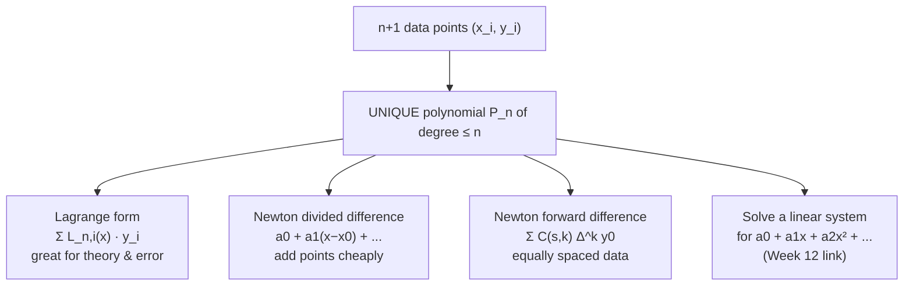
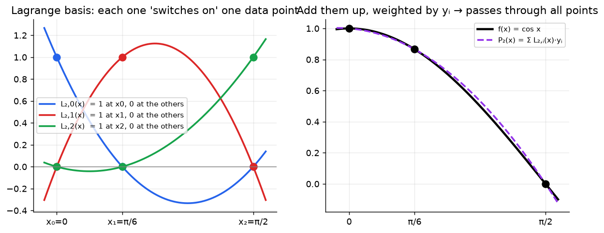

# Week 5: Interpolation & the Lagrange Form

> **The point:** you have **data points** (from an experiment, a table, or an ODE solver's output) but no formula. Interpolation builds a **polynomial that passes exactly through every point**, so you can estimate values **between** them, and later differentiate or integrate it (Weeks 10–11 are built on this).

**Exam link:** Q6 (6 marks): build a Lagrange polynomial and bound its error **or** find 3 bugs in Lagrange MATLAB code.

---

## 1. The key theorem: existence & uniqueness

> With $n+1$ **distinct** abscissas $x_0,\dots,x_n$ and values $y_0,\dots,y_n$, there is **exactly one** polynomial $P_n$ of degree $\le n$ with $P_n(x_i)=y_i$.

So Lagrange (Week 5), Newton divided differences (Week 6) and Newton forward differences (Week 7) all give **the same polynomial**, written differently.

**The "brute force" way** (Week 12 lecture problem): through $(-2,6),(1,-6),(3,-4)$, set $P_2=a_0+a_1x+a_2x^2$ and require it to hit each point:
$$\begin{cases}a_0-2a_1+4a_2=6\\a_0+a_1+a_2=-6\\a_0+3a_1+9a_2=-4\end{cases}\Rightarrow P_2(x)=x^2-3x-4$$
This works, but the forms below are cleverer.

---

## 2. The Lagrange form

$$\boxed{P_n(x)=\sum_{i=0}^n L_{n,i}(x)\,y_i,\qquad L_{n,i}(x)=\prod_{j=0,\,j\ne i}^{n}\frac{x-x_j}{x_i-x_j}}$$

**The key property:** $L_{n,i}(x_j)=\begin{cases}1&i=j\\0&i\ne j\end{cases}$. Each basis polynomial **switches on** exactly one data point.

### Three points, written out (memorise the pattern)
$$P_2(x)=\frac{(x-x_1)(x-x_2)}{(x_0-x_1)(x_0-x_2)}y_0+\frac{(x-x_0)(x-x_2)}{(x_1-x_0)(x_1-x_2)}y_1+\frac{(x-x_0)(x-x_1)}{(x_2-x_0)(x_2-x_1)}y_2$$

**How to build $L_{n,i}$:**
- **numerator:** multiply $(x-x_j)$ for **every node except $x_i$**
- **denominator:** the same product with $x$ replaced by $x_i$

---

## 3. Error: Lagrange remainder

$$f(x)=P_n(x)+R_n(x),\qquad R_n(x)=\frac{f^{(n+1)}(c)}{(n+1)!}(x-x_0)(x-x_1)\cdots(x-x_n),\quad c\in[a,b]$$

It looks just like the Taylor remainder, except $(x-x_0)^{n+1}$ becomes a **product over all nodes**. So the error is zero at each node, as it must be.

**Bound recipe:** $|R_n|\le\dfrac{\max|f^{(n+1)}|}{(n+1)!}\cdot\max\big|\prod(x-x_i)\big|$. The exam usually **gives you** the max of the product.

---

## 4. Worked: 2024 Q6 ($f=\cos x$, nodes $0,\ \pi/6,\ \pi/2$; bound on $[0,\pi/4]$)

> ⚠️ The official solution has wrong $y$-values (it writes $y_1=0.5$, $y_2=-1$). The correct values are below.

**(a)** $y_0=\cos0=1$, $y_1=\cos\frac\pi6=\frac{\sqrt3}2\approx0.8660$, $y_2=\cos\frac\pi2=0$

Denominators: $(0-\frac\pi6)(0-\frac\pi2)=\frac{\pi^2}{12}$, $\ (\frac\pi6-0)(\frac\pi6-\frac\pi2)=-\frac{\pi^2}{18}$, $\ (\frac\pi2-0)(\frac\pi2-\frac\pi6)=\frac{\pi^2}{6}$

$$P_2(x)=\frac{(x-\frac\pi6)(x-\frac\pi2)}{\pi^2/12}(1)+\frac{x(x-\frac\pi2)}{-\pi^2/18}\left(\tfrac{\sqrt3}{2}\right)+\frac{x(x-\frac\pi6)}{\pi^2/6}(0)$$

(No need to simplify. Marks are for the correct $y$ values, the Lagrange form and the final polynomial.)

**(b)** $f'''(x)=\sin x$, so
$$|R_2(x)|=\left|\frac{\sin c}{3!}\right|\left|x\left(x-\tfrac\pi6\right)\left(x-\tfrac\pi2\right)\right|<\frac{1}{6}\times0.17=\boxed{0.0283}$$
(using $|\sin c|\le1$ and the given fact $|x(x-\frac\pi6)(x-\frac\pi2)|<0.17$ on $[0,\pi/4]$). The actual maximum error is about $0.017$, so the bound holds.

---

## 5. Worked: a fresh example

$f(x)=\frac1x$, nodes $1,2,4$. Estimate $f(3)$ and bound the error.

$$L_{2,0}(3)=\frac{(3-2)(3-4)}{(1-2)(1-4)}=-\tfrac13,\quad L_{2,1}(3)=\frac{(3-1)(3-4)}{(2-1)(2-4)}=1,\quad L_{2,2}(3)=\frac{(3-1)(3-2)}{(4-1)(4-2)}=\tfrac13$$
$$P_2(3)=-\tfrac13(1)+1(0.5)+\tfrac13(0.25)=0.25\qquad(\text{true }0.3333,\ \text{error }0.0833)$$

**Bound:** $f'''=-6/x^4$, so $\frac{|f'''(c)|}{3!}=\frac1{c^4}\le1$ for $c\in[1,4]$. Also $|(3-1)(3-2)(3-4)|=2$, giving error $\le2$ ✓ (valid, but loose).

> Sanity check: $\sum_i L_{n,i}(x)=1$ for any $x$. Here $-\frac13+1+\frac13=1$ ✓

---

## 6. MATLAB bug catalogue: Lagrange code (Q6, 2023 & 2025)

| Year | Bug 1 | Bug 2 | Bug 3 |
|---|---|---|---|
| 2025 | `f = @(x) exp(x)*sin(5*x)` must be `.*` because `y = f(x)` passes a vector | `L21` denominator `(x(2)-x(1)).*(x(1)-x(3))` should be `(x(2)-x(1)).*(x(2)-x(3))` | `rel_err = .../P2(a)` should be `.../abs(f(a))` |
| 2023 | `f = @(x) exp(-x)*cos(5*x)` should be `exp(-x).*cos(5*x)` | Line 7 denominator `(x(3)-x(1))*(x(3)-x(1))` should be `(x(3)-x(1))*(x(3)-x(2))` | `rel_err = .../f(a)` should be `.../abs(f(a))` |

**Patterns:**
1. **Element-wise ops** (`.*`, `./`, `.^`) whenever a function is applied to a vector.
2. **Denominators:** basis $i$ uses $(x_i-x_j)$ for all $j\ne i$. Check every index.
3. **Relative error** $=|\text{approx}-\text{true}|/|\text{true}|$.
4. MATLAB indices start at 1: `x(1)` is $x_0$.

> Side note (2025): `L20 = @(x) (x-x(2))...` uses `x` both as the input and as the data vector. Inside the anonymous function, `x(2)` refers to the input, which is a real bug too. Naming the input `z` avoids it. The official answer lists the three above.

---

## Traps

- Don't confuse the **Lagrange remainder** (product of all $(x-x_i)$) with the **Taylor remainder** ($(x-x_0)^{n+1}$).
- Use $n+1$ derivatives for $n+1$ points: 3 points means degree 2, which means $f'''$.
- Interpolation is reliable **inside** $[x_0,x_n]$. See Week 7 for extrapolation.

---

## Practice

**P1.** Write $P_1$ through $(x_0,y_0),(x_1,y_1)$ in Lagrange form, and show that it's the straight line through the points.

Answer

$P_1=\frac{x-x_1}{x_0-x_1}y_0+\frac{x-x_0}{x_1-x_0}y_1$. This is linear in $x$, gives $y_0$ at $x_0$ and $y_1$ at $x_1$, so it must be the line.

**P2.** Lecture problem: $f=\frac1{1+x}$, nodes $0,2,3,4$. Approximate $f(1)$.

Answer

$y=(1,\frac13,\frac14,\frac15)$.
- $L_0(1)=\frac{(1-2)(1-3)(1-4)}{(0-2)(0-3)(0-4)}=\frac{-6}{-24}=0.25$
- $L_1(1)=\frac{(1)(-2)(-3)}{(2)(-1)(-2)}=1.5$
- $L_2(1)=\frac{(1)(-1)(-3)}{(3)(1)(-1)}=-1$
- $L_3(1)=\frac{(1)(-1)(-2)}{(4)(2)(1)}=0.25$

$P_3(1)=0.25+0.5-0.25+0.05=0.55$ (true $0.5$, error $0.05$).

