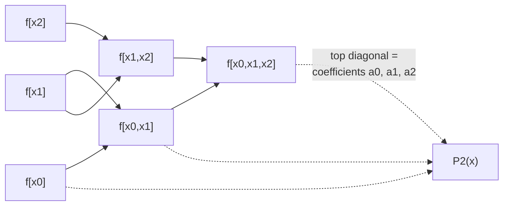
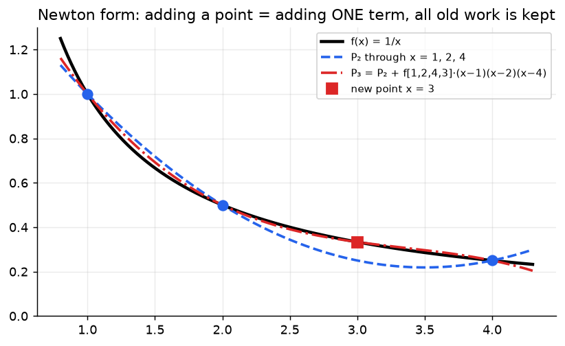

# Week 6: Newton Divided Difference Form

> **The point:** this is the **same unique polynomial** as Lagrange, but written so that **adding a new data point means adding one new term**. All previous work is kept. Lagrange would force you to start over. That makes it the practical, computer-friendly form.

**Exam link:** Q8 (4 marks): expand a divided difference like $f[x_0,x_1,x_2,x_3]$ purely in terms of $x_i$ and $y_i$ (2023 & 2025, identical questions).

---

## 1. The nested form

$$P_n(x)=a_0+a_1(x-x_0)+a_2(x-x_0)(x-x_1)+\cdots+a_n(x-x_0)(x-x_1)\cdots(x-x_{n-1})$$

Each new term vanishes at all the earlier nodes, so it **doesn't disturb** the fit there. That's why adding a point only adds a term.

Imposing $P_n(x_i)=y_i$ one point at a time gives a **triangular** system:
- $x_0$: $a_0=y_0$
- $x_1$: $a_0+a_1(x_1-x_0)=y_1\ \Rightarrow\ a_1=\dfrac{y_1-y_0}{x_1-x_0}$
- $x_2$: $a_2=\dfrac{\frac{y_2-y_1}{x_2-x_1}-\frac{y_1-y_0}{x_1-x_0}}{x_2-x_0}$, which gets messy, so we need notation.

## 2. Divided differences

$$f[x_i]=y_i,\qquad \boxed{f[x_i,\dots,x_{i+k}]=\frac{f[x_{i+1},\dots,x_{i+k}]-f[x_i,\dots,x_{i+k-1}]}{x_{i+k}-x_i}}$$

**Rule:** (drop the first point) minus (drop the last point), divided by (last $x$ minus first $x$).

Then $a_k=f[x_0,x_1,\dots,x_k]$, so

$$\boxed{P_n(x)=f[x_0]+f[x_0,x_1]\,(x-x_0)+f[x_0,x_1,x_2]\,(x-x_0)(x-x_1)+\cdots}$$

## 3. The divided-difference table

```
 x_i   zeroth      first          second              third
 x0    f[x0]
                 f[x0,x1]
 x1    f[x1]                  f[x0,x1,x2]
                 f[x1,x2]                       f[x0,x1,x2,x3]
 x2    f[x2]                  f[x1,x2,x3]
                 f[x2,x3]
 x3    f[x3]
```

- Each entry = (entry below-left − entry above-left) ÷ (difference of the outermost $x$'s it spans).
- **The top diagonal** gives the coefficients $a_0,a_1,a_2,\dots$
- **Adding a point** adds one row at the bottom and one new diagonal entry.



---

## 4. Worked example (fresh): $f=\frac1x$ at $x=1,2,4$, then add $x=3$

| $x_i$ | $f[x_i]$ | 1st | 2nd | 3rd |
|---|---|---|---|---|
| 1 | **1** | | | |
| | | $\frac{0.5-1}{2-1}=$ **−0.5** | | |
| 2 | 0.5 | | $\frac{-0.125-(-0.5)}{4-1}=$ **0.125** | |
| | | $\frac{0.25-0.5}{4-2}=-0.125$ | | $\frac{0.041667-0.125}{3-1}=$ **−0.041667** |
| 4 | 0.25 | | $\frac{-0.083333-(-0.125)}{3-2}=0.041667$ | |
| | | $\frac{0.3333-0.25}{3-4}=-0.083333$ | | |
| 3 | 0.3333 | | | |

$$P_2(x)=1-0.5(x-1)+0.125(x-1)(x-2)$$
$$P_3(x)=P_2(x)-0.041667(x-1)(x-2)(x-4)$$

At $x=1.5$ (true value $0.6667$):
- $P_2(1.5)=1-0.25+0.125(0.5)(-0.5)=0.71875$, error $0.052$
- $P_3(1.5)=0.71875-0.041667(0.5)(-0.5)(-2.5)=0.69271$, error $0.026$

Adding a point improved the estimate, **with only one extra term to compute**.



> 💡 The nodes **don't need to be in order** ($x_3=3$ sits between $2$ and $4$). Always divide by the outermost $x$'s of the entry.

### Lecture example ($\cos x$ at $0,\ \pi/2,\ \pi/6$, then add $\pi/4$)
$P_2(x)=1-0.6366x-0.3636\,x(x-1.5708)$ gives $\cos(\pi/3)\approx0.5327$ (error $0.0327$).
Add $\pi/4$: $P_3=P_2+0.1063\,x(x-1.5708)(x-0.5236)$ gives $0.5022$ (error $0.0022$).

---

## 5. Exam Q8: expand $f[x_0,x_1,x_2,x_3]$ (4 marks, 1 per line)

$$
\begin{aligned}
f[x_0,x_1,x_2,x_3]&=\frac{f[x_1,x_2,x_3]-f[x_0,x_1,x_2]}{x_3-x_0}\\[4pt]
&=\frac{\dfrac{f[x_2,x_3]-f[x_1,x_2]}{x_3-x_1}-\dfrac{f[x_1,x_2]-f[x_0,x_1]}{x_2-x_0}}{x_3-x_0}\\[4pt]
&=\frac{\dfrac{\frac{y_3-y_2}{x_3-x_2}-\frac{y_2-y_1}{x_2-x_1}}{x_3-x_1}-\dfrac{\frac{y_2-y_1}{x_2-x_1}-\frac{y_1-y_0}{x_1-x_0}}{x_2-x_0}}{x_3-x_0}
\end{aligned}
$$

Strategy: apply the definition once, then again to each piece, until only $f[x_i]=y_i$ remain. Write each level on its own line, because each line is a mark.

---

## Step-by-step: what each step is doing

| Step | What you do | Why |
|---|---|---|
| 1 | Column 0: write $f[x_i]=y_i$ | Zeroth divided differences are just the data |
| 2 | Column 1: $f[x_i,x_{i+1}]=\dfrac{y_{i+1}-y_i}{x_{i+1}-x_i}$ | The **slope** between neighbouring points |
| 3 | Column 2: (lower − upper of column 1) ÷ (last $x$ − first $x$ of the 3 points it spans) | The "slope of slopes", which measures curvature |
| 4 | Continue until one entry remains | Each column has one fewer entry |
| 5 | Read the **top diagonal** $f[x_0],f[x_0,x_1],f[x_0,x_1,x_2],\dots$ | These are the coefficients $a_0,a_1,a_2,\dots$ |
| 6 | $P_n=a_0+a_1(x-x_0)+a_2(x-x_0)(x-x_1)+\cdots$ | Each term vanishes at the earlier nodes, so it doesn't disturb the fit there |
| 7 | **Adding a point:** add a row at the bottom and compute **one** new entry per column | The new top-diagonal entry is the only new coefficient |

> **Denominator rule:** an entry built from $x_i,\dots,x_j$ divides by $x_j-x_i$ (last minus first of the **whole span**, not the neighbours).

### Worked example A: $(0,1),(1,0),(3,4)$, then add $(4,2)$

**Steps 1–4:**

| $x_i$ | col 0 | col 1 | col 2 | col 3 (after adding $x=4$) |
|---|---|---|---|---|
| 0 | **1** | | | |
| | | $\frac{0-1}{1-0}=$ **−1** | | |
| 1 | 0 | | $\frac{2-(-1)}{3-0}=$ **1** | |
| | | $\frac{4-0}{3-1}=2$ | | $\frac{-4/3-1}{4-0}=$ **−7/12** |
| 3 | 4 | | $\frac{-2-2}{4-1}=-\frac43$ | |
| | | $\frac{2-4}{4-3}=-2$ | | |
| 4 | 2 | | | |

- **Steps 5–6:** $P_2(x)=1-1(x-0)+1(x-0)(x-1)=x^2-2x+1=(x-1)^2$. Check: $P_2(3)=4$ ✓
- **Step 7:** $P_3(x)=P_2(x)-\frac7{12}\,x(x-1)(x-3)$. Check: $P_3(4)=9-\frac7{12}(4)(3)(1)=9-7=2$ ✓
- **Evaluate at $x=2$:** $P_2(2)=1$ and $P_3(2)=1-\frac7{12}(2)(1)(-1)=1+1.1667=\mathbf{2.1667}$

### Worked example B: why the "outermost $x$" rule matters

Nodes in the order $x_0=2$, $x_1=5$, $x_2=3$ (unsorted), with $y=(4,25,9)$ from $y=x^2$:
- $f[2,5]=\frac{25-4}{5-2}=7$ and $f[5,3]=\frac{9-25}{3-5}=8$
- $f[2,5,3]=\dfrac{8-7}{x_2-x_0}=\dfrac{1}{3-2}=\mathbf1$ ✓ (the leading coefficient of $x^2$)
- If you wrongly divided by $5-2$ you'd get $\frac13$ ✗

---

## 6. Why choose this form over Lagrange?

| | Lagrange | Newton divided difference |
|---|---|---|
| Add a point | start again | add 1 term |
| Error analysis | easy (remainder formula) | same polynomial, same error |
| Evaluate many times | more work | cheap (nested multiplication) |
| Spacing | any | any |

---

## Practice

**P1.** Build the divided-difference table for $(0,1),(1,3),(3,13)$ and write $P_2$. Then add $(2,7)$. What happens and why?
<details><summary>Answer</summary>

- $f[0,1]=2$, $f[1,3]=\frac{13-3}{2}=5$, $f[0,1,3]=\frac{5-2}{3}=1$
- So $P_2=1+2x+x(x-1)=x^2+x+1$

Adding $(2,7)$: $f[3,2]=\frac{7-13}{2-3}=6$, $f[1,3,2]=\frac{6-5}{2-1}=1$, $f[0,1,3,2]=\frac{1-1}{2-0}=0$.

The new coefficient is **0**, so $P_3=P_2$. The new point already lies on $x^2+x+1$ (check: $4+2+1=7$). Uniqueness in action.
</details>

**P2.** Show that $f[x_0,x_1]=f[x_1,x_0]$.
<details><summary>Answer</summary>

$\frac{y_1-y_0}{x_1-x_0}=\frac{y_0-y_1}{x_0-x_1}$. Divided differences are symmetric in their arguments.
</details>
