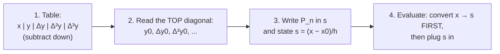
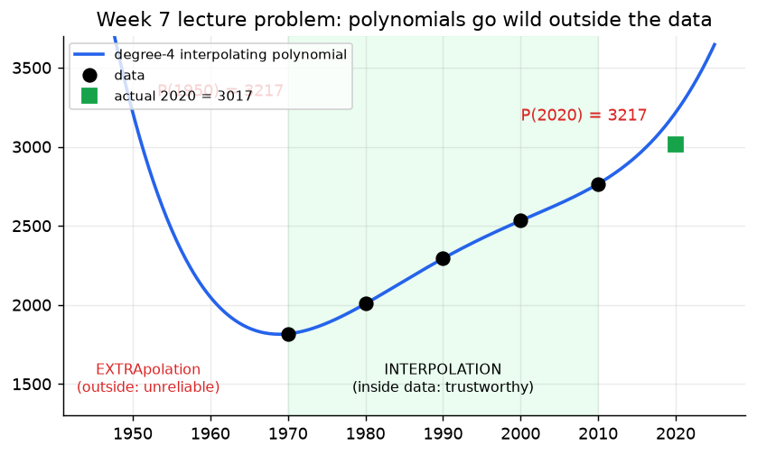

# Week 7: Newton Forward Difference Form (+ Extrapolation Warning)

> **The point:** when the data are **equally spaced** (step $h$), divided differences simplify to plain subtractions $\Delta y$. You build a **difference table** with no division, change variable to $s=(x-x_0)/h$, and the polynomial becomes a sum of binomial coefficients times the top-row differences. It's the **fastest** form to compute by hand, and it's the form used to **derive the Trapezoidal and Simpson's rules** in Week 11.

**Exam link:** Q7 (4 marks): **every single year**. Build the table, write $P_n$, evaluate at a point. Q8 (2024): prove $f[x_0,x_1,x_2]=\frac{\Delta^2y_0}{2!h^2}$. Q13 (2023, 2024): integrate this form to derive Trapezoid or Simpson.

---

## 1. Forward differences

$$\Delta y_i=y_{i+1}-y_i,\qquad \Delta^2y_i=\Delta y_{i+1}-\Delta y_i=y_{i+2}-2y_{i+1}+y_i,\qquad\Delta^3y_i=y_{i+3}-3y_{i+2}+3y_{i+1}-y_i$$

(The coefficients follow Pascal's triangle with alternating signs.)

## 2. The form

$$\boxed{P_n(x)=\sum_{k=0}^n\binom sk\Delta^ky_0=y_0+s\,\Delta y_0+\frac{s(s-1)}{2!}\Delta^2y_0+\frac{s(s-1)(s-2)}{3!}\Delta^3y_0+\cdots,\qquad s=\frac{x-x_0}{h}}$$

$$\binom sk=\frac{s(s-1)\cdots(s-k+1)}{k!}\quad\text{(works for non-integer }s)$$

**Link to divided differences:** $\ f[x_0,\dots,x_k]=\dfrac{\Delta^ky_0}{k!\,h^k}$. Substituting this and $x=x_0+sh$ into the Newton divided difference form gives the formula above.

## 3. The 4-step exam recipe

Mark split (2025): table 1.5, form 0.5, final polynomial 0.5, expression for $s$ 0.5, value of $s$ 0.5, answer 0.5.

---

## 4. Worked: 2025 Q7 ($\sin x$ at $0,\ \pi/4,\ \pi/2$; estimate $\sin(\pi/6)$)

$h=\pi/4$

| $x_i$ | $y_i$ | $\Delta y_i$ | $\Delta^2y_i$ |
|---|---|---|---|
| 0 | **0** | | |
| | | **0.7071** | |
| $\pi/4$ | 0.7071 | | **−0.4142** |
| | | 0.2929 | |
| $\pi/2$ | 1 | | |

$$P_2(x)=0+0.7071s+\frac{s(s-1)}{2}(-0.4142)=0.7071s-0.2071s(s-1),\qquad s=\frac{x-0}{\pi/4}=\frac{4x}{\pi}$$

**(b)** $x=\frac\pi6$ gives $s=\frac{4}{\pi}\cdot\frac\pi6=\frac23$, so
$$P_2=0.7071\cdot\tfrac23-0.2071\cdot\tfrac23\cdot\left(-\tfrac13\right)=\boxed{0.5174}\qquad(\text{true }0.5)$$

### Other years

| Exam | Data | Top diagonal | $P_n$ | Estimate |
|---|---|---|---|---|
| 2023 | $(1,1),(2,1.414),(3,1.732)$, $h=1$ | $1,\ 0.414,\ -0.096$ | $1+0.414s-0.048s(s-1)$, $s=x-1$ | $\sqrt{1.5}\approx P(s{=}0.5)=1.219$ |
| 2024 | $(1,0),(2,.6931),(3,1.0986),(4,1.3863)$ | $0,\ .6931,\ -.2876,\ .1698$ | $0.6931s-0.1438s(s-1)+0.0283s(s-1)(s-2)$, $s=x-1$ | $\log1.5\approx0.3931$ |
| Lecture | $(0,1),(0.5,1.6487),(1,2.7183)$ | $1,\ .6487,\ .4209$ | $1+0.6487s+0.21045s(s-1)$, $s=2x$ | $e^{1/3}\approx1.3857$ (true 1.3956) |

---

## 5. Proof: $f[x_0,x_1,x_2]=\dfrac{\Delta^2y_0}{2!h^2}$ (2024 Q8, 4 marks)

$$
\begin{aligned}
f[x_0,x_1,x_2]&=\frac{f[x_1,x_2]-f[x_0,x_1]}{x_2-x_0}
=\frac{\frac{y_2-y_1}{x_2-x_1}-\frac{y_1-y_0}{x_1-x_0}}{x_2-x_0}\\
&=\frac{\frac{y_2-y_1}{h}-\frac{y_1-y_0}{h}}{2h}\qquad(\text{equal spacing: }x_1-x_0=x_2-x_1=h,\ x_2-x_0=2h)\\
&=\frac{(y_2-y_1)-(y_1-y_0)}{2h^2}=\frac{y_2-2y_1+y_0}{2h^2}=\frac{\Delta^2y_0}{2!\,h^2}\ \blacksquare
\end{aligned}
$$

---

## Step-by-step: what each step is doing

| Step | What you do | Why |
|---|---|---|
| 1 | Check that the spacing is constant and find $h$ | This form only works for equal spacing |
| 2 | Column $\Delta y$: subtract each $y$ from the one below | First differences (rise per step) |
| 3 | Column $\Delta^2y$: subtract each $\Delta y$ from the one below | Change in the rise, i.e. curvature |
| 4 | Continue until one number remains | $n+1$ points give differences up to $\Delta^n$ |
| 5 | Read the **top diagonal** $y_0,\Delta y_0,\Delta^2y_0,\dots$ | These feed the formula |
| 6 | Write $P_n=y_0+s\Delta y_0+\frac{s(s-1)}{2!}\Delta^2y_0+\frac{s(s-1)(s-2)}{3!}\Delta^3y_0+\cdots$ | It's just the divided-difference form with $h$ absorbed |
| 7 | State $s=\frac{x-x_0}{h}$ | A separate mark, so don't forget it |
| 8 | To evaluate: compute $s$ from $x$ **first**, then substitute | The polynomial is in $s$, not $x$ |

> **Why no division?** Equal spacing makes every denominator a multiple of $h$, and those factors are collected into $k!\,h^k$ and absorbed by the $s$ substitution.

### Worked example A: $e^x$ at $0,0.25,0.5,0.75$; estimate $e^{0.1}$

**Step 1:** $h=0.25$

**Steps 2–4:**

| $x$ | $y$ | $\Delta y$ | $\Delta^2y$ | $\Delta^3y$ |
|---|---|---|---|---|
| 0 | **1.0000** | | | |
| | | **0.2840** | | |
| 0.25 | 1.2840 | | **0.0807** | |
| | | 0.3647 | | **0.0229** |
| 0.5 | 1.6487 | | 0.1036 | |
| | | 0.4683 | | |
| 0.75 | 2.1170 | | | |

**Steps 5–7:**
$$P_3=1+0.2840s+\frac{0.0807}{2}s(s-1)+\frac{0.0229}{6}s(s-1)(s-2),\qquad s=\frac{x}{0.25}=4x$$

**Step 8:** $x=0.1$ gives $s=0.4$:
- term 1: $1$
- term 2: $0.2840(0.4)=0.11360$
- term 3: $0.04035(0.4)(-0.6)=-0.00968$
- term 4: $0.003817(0.4)(-0.6)(-1.6)=+0.00147$

$$P_3=\mathbf{1.1054}\qquad(\text{true }e^{0.1}=1.1052)$$

### Worked example B: $f=\frac1{x+1}$ at $1,1.5,2$; estimate $f(1.2)$

- **Step 1:** $h=0.5$
- **Steps 2–4:** $y=(0.5,\ 0.4,\ 0.3333)$, $\Delta y=(-0.1,\ -0.0667)$, $\Delta^2y=0.0333$
- **Steps 5–7:** $P_2=0.5-0.1s+\frac{0.0333}{2}s(s-1)$, with $s=\frac{x-1}{0.5}=2(x-1)$
- **Step 8:** $x=1.2$ gives $s=0.4$, so $P_2=0.5-0.04+0.01665(0.4)(-0.6)=0.5-0.04-0.0040=\mathbf{0.4560}$ (true $0.4545$)

### Common slip: forgetting Step 8
Plugging $x=1.2$ straight into the $s$-polynomial gives $0.5-0.12+0.01665(1.2)(0.2)=0.384$ ✗. That's a completely wrong answer.

---

## 6. ⚠️ Interpolation vs extrapolation (lecture problem)

Population: 1970: 1817, 1980: 2007, 1990: 2293, 2000: 2532, 2010: 2765. With $h=10$ and $s=(\text{year}-1970)/10$:

| | $y$ | $\Delta$ | $\Delta^2$ | $\Delta^3$ | $\Delta^4$ |
|---|---|---|---|---|---|
| top diagonal | 1817 | 190 | 96 | −143 | 184 |

$$P_4=1817+190s+48s(s-1)-23.833s(s-1)(s-2)+7.6667s(s-1)(s-2)(s-3)$$

| Year | $s$ | $P_4$ | Realistic? |
|---|---|---|---|
| 2005 | 3.5 | 2640 | ✅ inside the data range, between 2532 and 2765 |
| 1950 | −2 | **3217** | ❌ bigger than in 1970? Extrapolating backwards blows up |
| 2020 | 5 | 3217 | ❌ the actual value was 3017 |

**Why:** a high-degree polynomial is pinned down only at the nodes. Outside them, its highest-power term takes over and it swings wildly. **Trust interpolation only inside $[x_0,x_n]$.**

**Adding the 2020 point (3017)** extends the table by one row: $\Delta=252$, $\Delta^2=19$, $\Delta^3=25$, $\Delta^4=-16$, $\Delta^5=-200$. So
$$P_5=P_4+\binom s5(-200)=P_4-1.6667\,s(s-1)(s-2)(s-3)(s-4)$$
Only one new term, just like Week 6.

---

## Traps

- **Convert $x$ to $s$ before evaluating.** Plugging $x$ straight into a polynomial in $s$ is the most common error.
- $s$ is usually **not** an integer. That's fine, because $\binom sk$ is defined by the product formula.
- Only use this form for **equally spaced** data. Otherwise use divided differences.
- Keep 4 decimal places in the table; rounding early shifts the answer.

---

## Practice

**P1.** Data $(0,1),(1,2),(2,5),(3,10)$. Find the Newton forward difference polynomial and estimate $f(1.5)$.

Answer

$h=1$, $s=x$. $\Delta$: $1,3,5$. $\Delta^2$: $2,2$. $\Delta^3$: $0$.

$P=1+s+\frac{s(s-1)}2\cdot2+0=1+s+s^2-s=s^2+1$, so $P(1.5)=3.25$.

Since $\Delta^3=0$, the data come from a quadratic.

**P2.** Express $\Delta^3 y_0$ in terms of the $y_i$.

Answer

$y_3-3y_2+3y_1-y_0$

