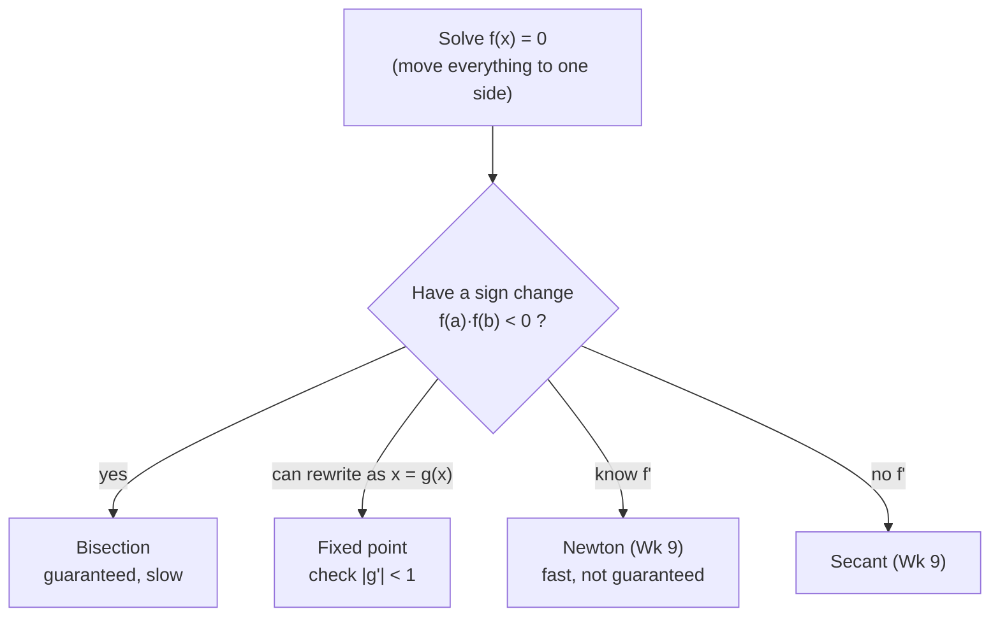
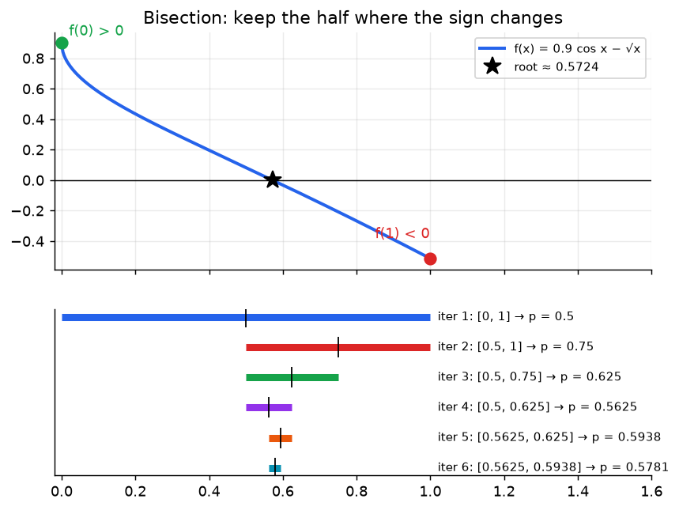
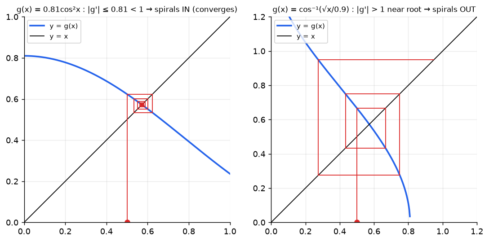

# Week 8: Roots of Nonlinear Functions I: Bisection & Fixed Point Iteration

> **The point:** you want the $x$ that makes $f(x)=0$, but algebra can't isolate it (e.g. $0.9\cos x=\sqrt x$). Root-finding methods produce a **sequence of guesses** $x_0,x_1,x_2,\dots$ that close in on the answer.
> - **Bisection:** a "higher or lower" guessing game. Slow, but **guaranteed** to work.
> - **Fixed point:** rewrite the equation as $x=g(x)$ and feed each output back in as the next input. Works only if $g$ "shrinks" distances ($|g'|<1$).

**Exam link:** Q9 (6 marks): show $[a,b]$ brackets a root, then do 2 bisection iterations (plus Newton/secant, Week 9). Q10 (2024): **MATLAB bisection bugs**.



**Any equation can be rewritten as $f(x)=0$:** e.g. $x^2-\sin x=e^x$ becomes $f(x)=x^2-\sin x-e^x=0$.

---

## 1. Intermediate Value Theorem → bracketing

> **IVT:** if $f$ is **continuous** on $[a,b]$ and $k$ lies between $f(a)$ and $f(b)$, then $f(c)=k$ for some $c\in[a,b]$.
>
> **Corollary:** if $f$ is continuous and $f(a)$, $f(b)$ have **opposite signs**, then $f$ has a root in $[a,b]$.

### Exam answer layout: "show $[a,b]$ is a bracketing" (2 marks)
> $f(1)=1^3-2(1)-7=-8$ and $f(3)=27-6-7=14$. **[0.5 + 0.5]**
> Since $f(1)$ and $f(3)$ have **opposite signs** (and $f$ is a continuous polynomial), $[1,3]$ is a bracketing for $f$. **[1]**

---

## 2. Bisection method

**Algorithm:**
1. Start with a bracket $[a,b]$ with $f(a)f(b)<0$.
2. $p=\dfrac{a+b}{2}$.
3. If $f(p)$ has the **same sign as $f(a)$**, set $a\leftarrow p$. Otherwise ($f(p)$ has the same sign as $f(b)$) set $b\leftarrow p$.
4. Repeat. **The approximation after $n$ iterations is the latest midpoint $p$.**



**Error:** the bracket halves every step, so after $n$ iterations the root is within $\frac{b-a}{2^n}$ of $p_n$. That's linear convergence with factor $\frac12$: about 3.3 iterations per extra decimal digit.

### Worked: 2025 Q9b, $f=x^3-2x-7$ on $[1,3]$

| iter | $a$ | $b$ | $p=\frac{a+b}2$ | $f(a)$ | $f(b)$ | $f(p)$ |
|---|---|---|---|---|---|---|
| 1 | 1 | 3 | 2 | − | + | $f(2)=-3$ **−** → $a=2$ |
| 2 | 2 | 3 | 2.5 | − | + | $f(2.5)=3.625$ **+** → $b=2.5$ |

**Approximate solution after 2 iterations: $x\approx2.5$.**

> ⚠️ **The official 2025 solution has errors here:** it lists $f(2.5)$ as negative and says the answer is $1.5$. In fact $f(2.5)=15.625-5-7=+3.625$, and the answer after 2 iterations is the midpoint $2.5$ (next bracket $[2,2.5]$).

### Worked: 2023 Q9b, $f=x^3-2x^2-x+1$ on $[-1,3]$
$f(-1)=-1$, $f(3)=7$.

| iter | $a$ | $b$ | $p$ | $f(p)$ |
|---|---|---|---|---|
| 1 | −1 | 3 | 1 | $1-2-1+1=-1$ (−) → $a=1$ |
| 2 | 1 | 3 | 2 | $8-8-2+1=-1$ (−) → $a=2$ |

Approximation: $x\approx2$.

### MATLAB bisection: correct version vs the 2024 Q10 bugs

```matlab
f = @(x) cos(3*x) - 2*x;
a = 0; b = 1;
for i = 1:100
    p = (a+b)/2;                    % BUG in exam: (b-a)/2
    if sign(f(a)) == sign(f(p))
        a = p;
    else
        b = p;                      % BUG in exam: a = b
    end
    if (b-a) <= 1e-4                % BUG in exam: (b-a) > 1e-4
        break;
    end
end
```

---

## 3. Fixed point iteration

A **fixed point** of $g$ is a $p$ with $p=g(p)$. Rearrange $f(x)=0$ into $x=g(x)$, then iterate
$$\boxed{x_{n+1}=g(x_n)}$$

**Geometrically:** you're finding where the curve $y=g(x)$ crosses the line $y=x$.



The **same equation** can be rearranged in many ways. Some rearrangements converge and some blow up:

| Rearrangement of $0.9\cos x=\sqrt x$ | Iterates from $x_0=0.5$ | Result |
|---|---|---|
| $g_1(x)=\cos^{-1}\!\left(\frac{\sqrt x}{0.9}\right)$ | 0.667, 0.444, 0.750, 0.276, 0.948, undefined | ❌ diverges |
| $g_2(x)=0.81\cos^2x$ | 0.624, 0.534, 0.600, … → **0.57** | ✅ converges |

### Fixed Point Theorem (when is convergence guaranteed?)
If on $[a,b]$:
1. $g$ is continuous,
2. $g(x)\in[a,b]$ for all $x\in[a,b]$ ($g$ maps the interval into itself),
3. $g$ is differentiable and $|g'(x)|\le k<1$,

then $g$ has a **unique** fixed point in $[a,b]$, and the iteration converges to it for **any** $x_0\in[a,b]$.

**Checking it for $g_2=0.81\cos^2x$ on $[0,1]$:**
1. Continuous ✓
2. $0\le\cos^2x\le1$, so $0\le g\le0.81$, which lies in $[0,1]$ ✓
3. $g'=-1.62\cos x\sin x$, so $|g'|\le1.62\cdot1\cdot\sin1=1.36$. That's too crude. Use $2\sin x\cos x=\sin 2x$ instead: $|g'|=0.81|\sin2x|\le0.81<1$ ✓

**Convergence speed:** linear, $|x_{n+1}-p|\approx\lambda|x_n-p|$ with $\lambda\approx|g'(p)|$. If $\lambda=0.1$ you gain about 1 digit per iteration.

**In practice:** just try a rearrangement. If it's going to fail, it usually fails within a few iterations, so switch to another one.

---

## Traps

- Bisection: compare signs with $f(a)$, not with zero. Keep the half **with the sign change**.
- The midpoint is $(a+b)/2$, **not** $(b-a)/2$.
- The stopping test is "stop when $(b-a)\le$ tol" (`break` when **small**).
- Bisection needs **continuity**. A sign change across a discontinuity (e.g. $\tan x$) is not a root.
- Fixed point: the theorem gives a **sufficient** condition, so check all 3 conditions.

---

## Practice

**P1.** $f(x)=x^3+x-1$. Show $[0,1]$ brackets a root and do 3 bisection iterations.
<details><summary>Answer</summary>

$f(0)=-1<0$ and $f(1)=1>0$, so there is a sign change and $[0,1]$ brackets a root.

| iter | $a$ | $b$ | $p$ | $f(p)$ |
|---|---|---|---|---|
| 1 | 0 | 1 | 0.5 | −0.375 → a |
| 2 | 0.5 | 1 | 0.75 | +0.1719 → b |
| 3 | 0.5 | 0.75 | 0.625 | −0.1309 → a |

$x\approx0.625$ (true root 0.6823).
</details>

**P2.** Same equation, using $g(x)=\frac{1}{1+x^2}$ and $x_0=0.5$: do 3 iterations. Will it converge?
<details><summary>Answer</summary>

$x_1=0.8$, $x_2=0.6098$, $x_3=0.7289$.

$g'(x)=\frac{-2x}{(1+x^2)^2}$, and near the root $|g'(0.68)|\approx0.64<1$, so it converges (slowly, oscillating).
</details>
