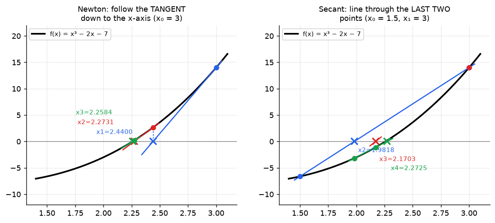
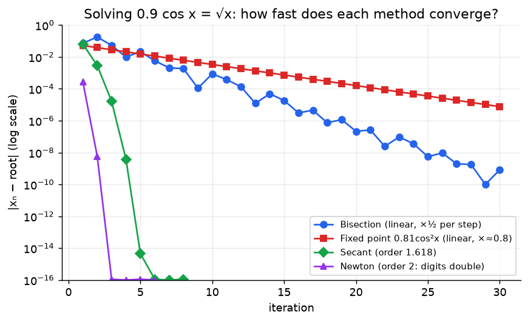

# Week 9: Roots II: Newton's Method, Secant Method & Convergence Rates

> **The point:** bisection ignores the **shape** of $f$. Newton uses the **tangent line** (the degree-1 Taylor polynomial) to jump straight towards the root, and the number of correct digits roughly **doubles** every step. Secant does the same with a **secant line** when you don't have $f'$. The price for this speed is that neither is guaranteed to converge.

**Exam link:** Q9(b,c) (4 marks): 1 iteration of Newton and/or secant. Q10 (3–4 marks): derive Newton **or** fix Newton MATLAB code. **Q11 (4 marks, every year): derive an iteration for $\sqrt a$ or $\sqrt[3]a$.**

---

## 1. Newton's method

$$\boxed{x_{n+1}=x_n-\frac{f(x_n)}{f'(x_n)}}$$

### Derivation (2025 Q10, 3 marks)
> Approximate $f(x)$ by its **tangent line** at $x=x_n$ (the degree-1 Taylor polynomial): **[1]**
> $$f(x)\approx f(x_n)+f'(x_n)(x-x_n)$$
> Let $x_{n+1}$ be the $x$-intercept of the tangent line: **[1]**
> $$0=f(x_n)+f'(x_n)(x_{n+1}-x_n)$$
> Solve: $x_{n+1}-x_n=-\dfrac{f(x_n)}{f'(x_n)}\ \Rightarrow\ x_{n+1}=x_n-\dfrac{f(x_n)}{f'(x_n)}$ **[1]**

## 2. Secant method

Replace $f'(x_n)$ by the slope of the line through the **last two** iterates:
$$f'(x_n)\approx\frac{f(x_n)-f(x_{n-1})}{x_n-x_{n-1}}\quad\Rightarrow\quad\boxed{x_{n+1}=x_n-f(x_n)\frac{x_n-x_{n-1}}{f(x_n)-f(x_{n-1})}}$$

It needs **two** starting values $x_0,x_1$ and **no derivative**.



---

## 3. Worked (past exams)

### 2024 Q9: $f=x^4-4x^3+2x+3$
$f(1)=2$, $f(2)=-9$, $f'(x)=4x^3-12x^2+2$, $f'(1)=-6$

- **Newton** ($x_0=1$): $x_1=1-\dfrac{2}{-6}=\boxed{\tfrac43=1.3333}$
- **Secant** ($x_0=1,\ x_1=2$): $x_2=2-(-9)\dfrac{2-1}{-9-2}=2-\dfrac{9}{11}=\boxed{\tfrac{13}{11}=1.1818}$

### 2025 Q9c: $f=x^3-2x-7$, Newton from $x_0=2$
$f(2)=-3$, $f'(x)=3x^2-2$, $f'(2)=10$, so $x_1=2-\frac{-3}{10}=\boxed{2.3}$

### 2023 Q9c: $f=x^3-2x^2-x+1$, secant from $x_0=0,\ x_1=1$
$f(0)=1$, $f(1)=-1$, so $x_2=1-(-1)\dfrac{1-0}{-1-1}=1-\tfrac12=\boxed{0.5}$

Marks: 0.5 for the form of the method, 0.5 for the derivative (Newton), 1 for the computation.

---

## 4. Q11: derive an iteration for a root of $a$ (every year)

**Strategy:** choose $f(x)$ whose root **is** the number you want, apply the method, then simplify.

| Want | Choose | Method | Result |
|---|---|---|---|
| $\sqrt a$ | $f=x^2-a$ | Newton | $x_{n+1}=\frac12\left(x_n+\frac a{x_n}\right)$ (Heron's method) |
| $\sqrt[3]a$ | $f=x^3-a$ | Newton | $x_{n+1}=\frac{2x_n}{3}+\frac{a}{3x_n^2}$ (2024) |
| $\sqrt a$ | $f=x^2-a$ | Secant | $x_{n+1}=x_n+\frac{a-x_n^2}{x_n+x_{n-1}}$ (2025) |
| $1/a$ | $f=\frac1x-a$ | Newton | $x_{n+1}=x_n(2-ax_n)$ (division-free!) |

### 2024 Q11 (Newton, $\sqrt[3]a$)
$f=x^3-a$ **[1.5]**, $f'=3x^2$
$$x_{n+1}=x_n-\frac{x_n^3-a}{3x_n^2}=x_n-\frac{x_n}{3}+\frac{a}{3x_n^2}=\frac{2x_n}{3}+\frac{a}{3x_n^2}$$

### 2025 Q11 (secant, $\sqrt a$): the key step is **difference of squares**
$f=x^2-a$ **[1]**
$$x_{n+1}=x_n-(x_n^2-a)\frac{x_n-x_{n-1}}{(x_n^2-a)-(x_{n-1}^2-a)}=x_n-(x_n^2-a)\frac{x_n-x_{n-1}}{(x_n+x_{n-1})(x_n-x_{n-1})}$$
$$=x_n-\frac{x_n^2-a}{x_n+x_{n-1}}=x_n+\frac{a-x_n^2}{x_n+x_{n-1}}$$

### Heron (lecture): $\sqrt2$ from $x_0=1$
$1\to1.5\to1.4166667\to1.4142157\to1.4142136$. Correct digits go roughly 0, 1, 3, 6, 12: they **double**.

---

## 5. Convergence: the comparison table you need

| Method | Error behaviour | Order | Needs | Guaranteed? |
|---|---|---|---|---|
| Bisection | halves each step | 1 (linear), factor ½ | bracket | ✅ |
| Fixed point | $\lvert x_{n+1}-p\rvert\approx\lambda\lvert x_n-p\rvert$, $0<\lambda<1$ | 1 (linear) | good $g$ | if $\lvert g'\rvert<1$ |
| Secant | $\lvert x_{n+1}-p\rvert\approx\lambda\lvert x_n-p\rvert^{1.618}$ | $\frac{1+\sqrt5}{2}$ (golden ratio) | $x_0,x_1$ | ❌ |
| Newton | $\lvert x_{n+1}-p\rvert\approx\lambda\lvert x_n-p\rvert^{2}$ | 2 (quadratic): digits double | $f'$, $x_0$ | ❌ |



**Secant is slower than Newton because of the price of approximating the derivative.** But each secant step needs only one new $f$-evaluation and no $f'$, so in practice it's often competitive.

### When do Newton and secant fail?
- $f'(x_n)=0$ (horizontal tangent) means division by zero.
- A bad starting guess can make the iterates jump away or cycle.
- Secant: $f(x_n)=f(x_{n-1})$ means division by zero.

So in practice you often bracket with bisection first, then finish with Newton.

---

## 6. MATLAB Newton bugs (2023 Q10, 2 errors, 4 marks)

```matlab
f = @(x) exp(2*x) - 10*x;
fdash = @(x) 2*exp(2*x) - 10;
i = 0; x = 0.2; x_old = Inf; tol = 1e-4; maxiters = 100;
while abs(x - x_old) > tol && i < maxiters   % BUG was: < tol (loop never runs)
    x_old = x;
    x = x - f(x)/fdash(x);                   % BUG was: fdash(x)/f(x) (upside down)
    i = i + 1;
end
```

**Loop-condition logic:** `while` keeps going **while NOT converged**, so the condition is `> tol`. `if ... break` exits **when converged**, so the condition is `<= tol`.

---

## Traps

- The secant formula has $f(x_n)$ **outside** and $(x_n-x_{n-1})/(f(x_n)-f(x_{n-1}))$ as the fraction. Keep the indices consistent.
- One iteration of secant from $x_0,x_1$ produces $x_2$ (not $x_1$).
- Write the general formula first: it's worth 0.5 marks.
- Leave fractions exact ($\frac43$, $\frac{13}{11}$) **and** give decimals.

---

## Practice

**P1.** Two Newton iterations for $\sqrt5$ (use $f=x^2-5$) from $x_0=2$. Then one secant iteration from $x_0=2$, $x_1=3$.
<details><summary>Answer</summary>

Newton: $x_1=2-\frac{-1}{4}=2.25$, $x_2=2.25-\frac{0.0625}{4.5}=2.236111$ (true $2.236068$).

Secant: $x_2=3-4\cdot\frac{3-2}{4-(-1)}=3-0.8=2.2$
</details>

**P2.** Derive Newton's iteration for computing $1/a$ without division.
<details><summary>Answer</summary>

$f=\frac1x-a$, $f'=-\frac1{x^2}$.

$x_{n+1}=x_n-\frac{1/x_n-a}{-1/x_n^2}=x_n+x_n^2\left(\frac1{x_n}-a\right)=x_n+x_n-ax_n^2=x_n(2-ax_n)$
</details>

**P3.** Show that Heron's method $x_{n+1}=\frac12(x_n+A/x_n)$ is Newton's method for $x^2-A=0$.
<details><summary>Answer</summary>

$x_n-\frac{x_n^2-A}{2x_n}=x_n-\frac{x_n}{2}+\frac{A}{2x_n}=\frac12\left(x_n+\frac{A}{x_n}\right)$
</details>
