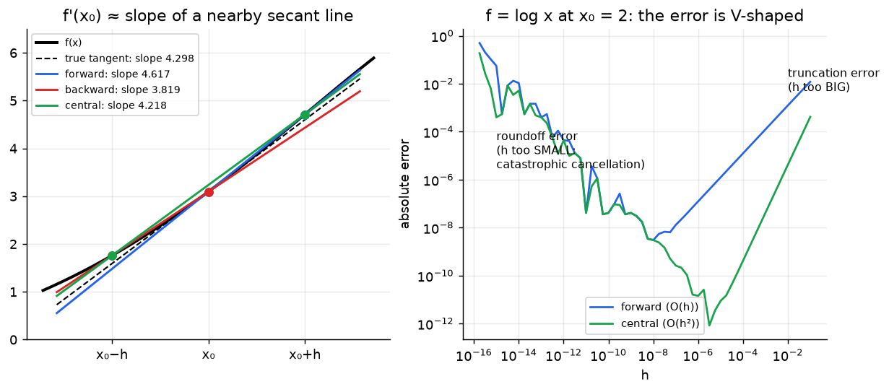
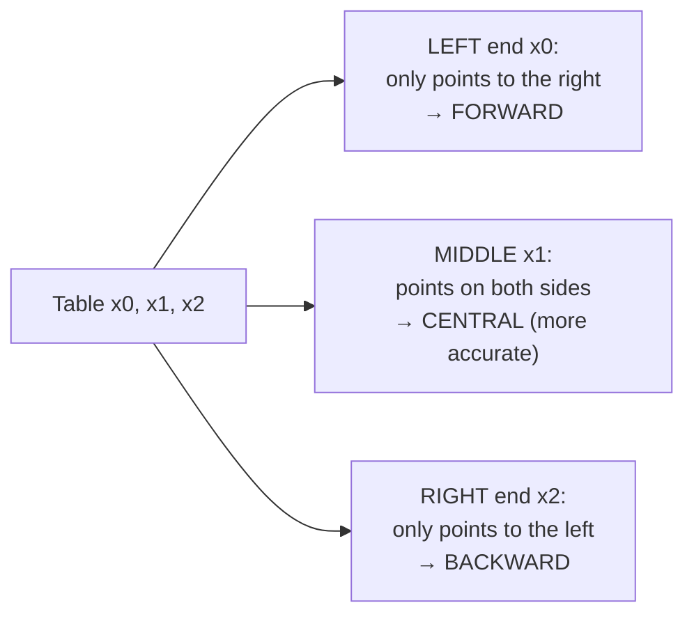

# Week 10: Numerical Differentiation

> **The point:** you need $f'(x_0)$ but you **don't have a formula**. You only have a **table of values** or a **black box** that returns $f(x)$. The definition $f'(x)=\lim_{h\to0}\frac{f(x+h)-f(x)}{h}$ suggests using a **small but finite $h$**: the slope of a nearby secant line. Taylor expansions tell you exactly **how accurate** each formula is.
>
> It's used elsewhere in the unit too: the Modified Euler derivation (Week 4) and the secant method (Week 9) both rely on a finite-difference approximation of a derivative.

**Exam link:** Q11 (2023, 6 marks): derive the $f''$ formula and explain the choice of $h$. **Q12 (4 marks, every year): compute $f'$ and $f''$ from a table.**

---

## 1. The formulas (A4 sheet)

| Name | Formula | Error term | Order | Points used |
|---|---|---|---|---|
| 1st-order **forward** | $f'(x_0)\approx\dfrac{f(x_0+h)-f(x_0)}{h}$ | $-\dfrac h2f''(c)$ | $O(h)$ | $x_0,\ x_0+h$ |
| 1st-order **backward** | $f'(x_0)\approx\dfrac{f(x_0)-f(x_0-h)}{h}$ | $+\dfrac h2f''(c)$ | $O(h)$ | $x_0-h,\ x_0$ |
| 2nd-order **central** ($f'$) | $f'(x_0)\approx\dfrac{f(x_0+h)-f(x_0-h)}{2h}$ | $-\dfrac{h^2}6f'''(c)$ | $O(h^2)$ | $x_0\pm h$ |
| 2nd-order **central** ($f''$) | $f''(x_0)\approx\dfrac{f(x_0-h)-2f(x_0)+f(x_0+h)}{h^2}$ | $-\dfrac{h^2}{12}f^{(4)}(c)$ | $O(h^2)$ | $x_0-h,\ x_0,\ x_0+h$ |
| 2nd-order **forward** ($f'$) | $f'(x_0)\approx\dfrac{-3f(x_0)+4f(x_0+h)-f(x_0+2h)}{2h}$ | $O(h^2)$ | $O(h^2)$ | $x_0,\ x_0+h,\ x_0+2h$ |

### Which formula for which point in a table?

> ⚠️ The **2025 official solution calls its Q12(a) formula "backward"**, but $\frac{f(0.3)-f(0.15)}{0.15}$ at $x_0=0.15$ is a **forward** difference. At the left end of a table, forward is the only option.

---

## 2. Derivations (all from Taylor + algebra)

Write Taylor in terms of $h$: $f(x_0+h)=f(x_0)+hf'(x_0)+\frac{h^2}{2}f''(x_0)+\frac{h^3}{6}f'''(x_0)+\cdots$

### (a) Forward difference
$$f(x_0+h)=f(x_0)+hf'(x_0)+\tfrac{h^2}{2}f''(c)\ \Rightarrow\ f'(x_0)=\frac{f(x_0+h)-f(x_0)}{h}-\frac h2f''(c)$$
Replacing $h$ by $-h$ gives the backward difference.

### (b) Central difference for $f'$: **subtract**
$$f(x_0+h)=f_0+hf'_0+\tfrac{h^2}2f''_0+\tfrac{h^3}6f'''(c_1)\qquad(1)$$
$$f(x_0-h)=f_0-hf'_0+\tfrac{h^2}2f''_0-\tfrac{h^3}6f'''(c_2)\qquad(2)$$
$(1)-(2)$: the even terms cancel, giving $f(x_0+h)-f(x_0-h)=2hf'_0+\frac{h^3}6[f'''(c_1)+f'''(c_2)]$. So
$$f'(x_0)=\frac{f(x_0+h)-f(x_0-h)}{2h}-\frac{h^2}{6}\underbrace{\frac{f'''(c_1)+f'''(c_2)}{2}}_{=f'''(c)\text{ by IVT}}$$

### (c) Central difference for $f''$ (2023 Q11a, 4 marks): **add**
Expand to degree 3 with an $h^4$ remainder: **[1]**
$$f(x_0\pm h)=f_0\pm hf'_0+\tfrac{h^2}{2}f''_0\pm\tfrac{h^3}{6}f'''_0+\tfrac{h^4}{24}f^{(4)}(c_{1,2})$$
**Add** them, so the odd terms cancel: **[1]**
$$f(x_0+h)+f(x_0-h)=2f_0+h^2f''_0+\tfrac{h^4}{24}\left[f^{(4)}(c_1)+f^{(4)}(c_2)\right]$$
Rearrange: **[1]**
$$f''(x_0)=\frac{f(x_0-h)-2f(x_0)+f(x_0+h)}{h^2}-\frac{h^2}{12}\cdot\frac{f^{(4)}(c_1)+f^{(4)}(c_2)}{2}$$
**IVT:** if $f^{(4)}$ is continuous on $[x_0-h,x_0+h]$, there is a $c$ between $c_1$ and $c_2$ with $f^{(4)}(c)=\frac{f^{(4)}(c_1)+f^{(4)}(c_2)}{2}$. **[1]**

**Rule of thumb:** subtracting cancels the even terms (good for $f'$). Adding cancels the odd terms (good for $f''$).

### (d) 2nd-order forward (lecture problem 3)
Compute $4\times f(x_0+h)-f(x_0+2h)$ to cancel the $h^2$ terms:
$$4f(x_0+h)-f(x_0+2h)=3f_0+2hf'_0+O(h^3)\ \Rightarrow\ f'_0=\frac{-3f_0+4f(x_0+h)-f(x_0+2h)}{2h}+O(h^2)$$

---

## 3. Worked examples

### Lecture: $f=\log x$ at $x_0=2$ (exact $f'=0.5$, $f''=-0.25$)

| $h$ | forward | backward | central $f'$ | central $f''$ |
|---|---|---|---|---|
| 0.1 | 0.4879 (err $1.2\times10^{-2}$) | 0.5129 | 0.50042 (err $4.2\times10^{-4}$) | −0.250313 |
| 0.01 | 0.4988 (err $1.2\times10^{-3}$) | 0.5013 | 0.5000042 (err $4.2\times10^{-6}$) | −0.2500031 |

Making $h$ 10× smaller makes the error 10× smaller for the 1st-order formulas and **100× smaller** for the 2nd-order ones. That's what "order" means.

### 2025 Q12 (table $x$: 0.15, 0.3, 0.45; $f$: 1.3516, 1.3043, 1.2419)
**(a)** $f'(0.15)$ from two values, at the left end, so **forward** with $h=0.15$:
$$f'(0.15)\approx\frac{1.3043-1.3516}{0.15}=\boxed{-0.3153}$$
**(b)** $f''(0.3)$ from all three, central:
$$f''(0.3)\approx\frac{1.3516-2(1.3043)+1.2419}{0.15^2}=\frac{-0.0151}{0.0225}=\boxed{-0.6711}$$

### 2024 Q12 ($f=(x^2+1)e^{-x}$, $h=0.1$)
$f(0.1)=0.9139$, $f(0.2)=0.8515$, $f(0.3)=0.8075$
- (a) backward: $f'(0.2)\approx\frac{0.8515-0.9139}{0.1}=-0.6241$
- (b) central: $f''(0.2)\approx\frac{0.8075-2(0.8515)+0.9139}{0.01}=1.8418$

### 2023 Q12 (table $x$: 1, 1.1, 1.2; $f$: 0.5679, 0.6542, 0.7286)
- (a) $f'(1.2)$, right end, so backward: $\frac{0.7286-0.6542}{0.1}=0.7440$
- (b) $f'(1.1)$ from $f(1)$ and $f(1.2)$, central with $h=0.1$: $\frac{0.7286-0.5679}{0.2}=0.8035$

---

## 4. Instability: choosing $h$ (2023 Q11b, 2 marks)

Every formula **subtracts nearly-equal numbers** and **divides by a small number**, so it is **numerically unstable**.

> **Model answer:** "Too **large** a value of $h$ gives inaccuracy from **truncation error** (the neglected Taylor terms, $O(h^p)$). Too **small** a value of $h$ gives inaccuracy from **roundoff error** (catastrophic cancellation in the numerator, magnified by dividing by $h$)."

The right-hand plot above shows the V-shape: the best $h$ is about $10^{-8}$ for forward differences ($\approx\sqrt{\text{eps}}$) and about $10^{-5}$ for central. Going smaller makes things **worse**.

---

## Traps

- Central $f'$ divides by $2h$; central $f''$ divides by $h^2$. Don't swap them.
- $h$ is the spacing between table entries, not the $x$ value.
- Read the question: "using only two values" means a 1st-order formula, or central if the two values sit either side of the point.
- For derivations: state where the $c$'s lie, and **mention the IVT** when you merge two $c$'s into one (it's worth a mark).

---

## Practice

Table for $f(x)=e^x\sin x$: $x=1.0,\ 1.2,\ 1.4$; $f=2.2874,\ 3.0945,\ 3.9962$.

**P1.** Approximate $f'(1.0)$, $f'(1.4)$, $f'(1.2)$ and $f''(1.2)$. Compare with the exact values $3.7560,\ 4.6854,\ 4.2975,\ 2.4061$.

Answer

- forward $f'(1.0)\approx\frac{3.0945-2.2874}{0.2}=4.0355$ (err 0.28)
- backward $f'(1.4)\approx\frac{3.9962-3.0945}{0.2}=4.5085$ (err 0.18)
- central $f'(1.2)\approx\frac{3.9962-2.2874}{0.4}=4.2720$ (err **0.026**: much better)
- $f''(1.2)\approx\frac{2.2874-2(3.0945)+3.9962}{0.04}=2.365$ (err 0.04)

**P2.** Why can't you use a central difference for $f'(1.0)$ here?

Answer

It needs $f(0.8)$, which isn't in the table. At the left end only forward differences are possible.

