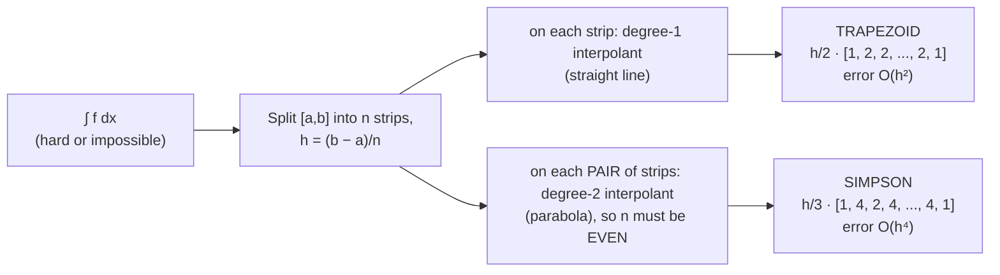
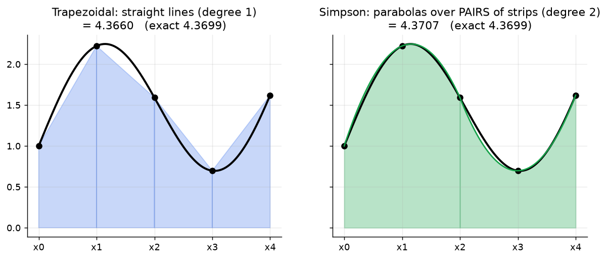

# Week 11: Numerical Integration (Quadrature): Trapezoidal & Simpson's Rules

> **The point:** you need a **definite integral** $\int_a^bf(x)\,dx$, either because no antiderivative exists ($e^{-x^2}$, $\sqrt{1+\cos^2x}$) or because you only have a **table of values**. You replace $f$ on each little strip by an **interpolating polynomial** (Weeks 5–7), which is easy to integrate exactly, and add up the strips. The result is always a **weighted sum of function values**.

**Exam link:** **Q14 (6 marks, every year): Trapezoid + Simpson with $n=4$ from a table.** Q13: derive a rule (2023, 2024) **or** find trapezoid MATLAB bugs (2025). "Which is more accurate?" (2023 Q14c).



---

## 1. The rules (A4 sheet)

$$h=\frac{b-a}{n},\qquad x_i=a+ih$$

$$\boxed{\text{Trapezoid: }\int_a^bf\,dx\approx\frac h2\Big[f(x_0)+2\sum_{i=1}^{n-1}f(x_i)+f(x_n)\Big]}\qquad\text{error}=-\frac{(b-a)h^2}{12}f''(c)$$

$$\boxed{\text{Simpson: }\int_a^bf\,dx\approx\frac h3\Big[f(x_0)+4\!\!\sum_{\text{odd }i}\!\!f(x_i)+2\!\!\!\sum_{\text{even interior }i}\!\!\!f(x_i)+f(x_n)\Big]}\quad\text{error}=-\frac{(b-a)h^4}{180}f^{(4)}(c)$$

For $n=4$ (what the exam always uses):

| | $f_0$ | $f_1$ | $f_2$ | $f_3$ | $f_4$ | prefactor |
|---|---|---|---|---|---|---|
| Trapezoid | 1 | 2 | 2 | 2 | 1 | $h/2$ |
| Simpson | 1 | **4** | 2 | **4** | 1 | $h/3$ |

| Property | Trapezoid | Simpson |
|---|---|---|
| Interpolant per piece | degree 1 (line) | degree 2 (parabola) |
| Order | **2nd** ($O(h^2)$) | **4th** ($O(h^4)$) |
| Exact for polynomials of degree | $\le1$ (error has $f''$) | $\le3$ (error has $f^{(4)}$) |
| $n$ | any | **must be even** |



---

## 2. Derivations: integrate the Newton forward difference interpolant

**The key substitution:** $x=x_0+sh$, so $dx=h\,ds$. Then $x=x_0$ gives $s=0$, $x=x_1$ gives $s=1$, and $x=x_2$ gives $s=2$.

### Trapezoid (2023 Q13, 3 + 2 marks)
**(a)** $P_1(x)=y_0+s\Delta y_0$ **[1]**
$$\int_{x_0}^{x_1}P_1\,dx=\int_0^1(y_0+s\Delta y_0)\,h\,ds=h\Big[y_0s+\tfrac12s^2\Delta y_0\Big]_0^1\ \textbf{[1]}=h\left[y_0+\tfrac12(y_1-y_0)\right]=\frac h2\left[f(x_0)+f(x_1)\right]\ \textbf{[1]}$$

**(b)** Apply this to every strip and add: **[1]**
$$\int_a^b=\int_{x_0}^{x_1}+\int_{x_1}^{x_2}+\cdots+\int_{x_{n-1}}^{x_n}\approx\frac h2[f_0+f_1]+\frac h2[f_1+f_2]+\cdots+\frac h2[f_{n-1}+f_n]$$
Every interior point appears **twice**: **[1]**
$$=\frac h2\Big[f_0+2(f_1+\cdots+f_{n-1})+f_n\Big]$$

### Simpson (2024 Q13, 5 marks)
$P_2(x)=y_0+s\Delta y_0+\frac{s(s-1)}{2}\Delta^2y_0$ **[1]**
$$\int_{x_0}^{x_2}P_2\,dx=h\int_0^2\Big(y_0+s\Delta y_0+\big(\tfrac12s^2-\tfrac12s\big)\Delta^2y_0\Big)ds=h\Big[y_0s+\tfrac12s^2\Delta y_0+\big(\tfrac16s^3-\tfrac14s^2\big)\Delta^2y_0\Big]_0^2\ \textbf{[1]}$$
$$=h\Big[2y_0+2\Delta y_0+\tfrac13\Delta^2y_0\Big]$$
Substitute $\Delta y_0=y_1-y_0$ and $\Delta^2y_0=y_2-2y_1+y_0$: **[1]**
$$=h\Big[2y_0+2y_1-2y_0+\tfrac13y_2-\tfrac23y_1+\tfrac13y_0\Big]=h\Big[\tfrac13y_0+\tfrac43y_1+\tfrac13y_2\Big]\ \textbf{[1]}=\frac h3\big[f(x_0)+4f(x_1)+f(x_2)\big]\ \textbf{[1]}$$
For the composite rule, add over the pairs $[x_0,x_2],[x_2,x_4],\dots$: the odd points get weight 4 and the even interior points (shared by two pairs) get weight $1+1=2$.

---

## 3. Worked examples

### 2025 Q14 ($x$: 0, 0.5, 1, 1.5, 2; $f$: 1.3710, 1.2194, 1.0031, 0.8690, 0.8297), $h=0.5$
$$T=\frac{0.5}{2}\big[1.3710+2(1.2194+1.0031+0.8690)+0.8297\big]=0.25\times8.3837=\boxed{2.0959}$$
$$S=\frac{0.5}{3}\big[1.3710+4(1.2194)+2(1.0031)+4(0.8690)+0.8297\big]=\tfrac16\times12.5605=\boxed{2.0934}$$

### 2024 Q14 ($h=0.25$; $f$: 0.9917, 0.5794, 0.3145, 0.1550, 0.0648)
$T=0.3943$, $S=0.3853$

### 2023 Q14 ($f=\cos(x^2)$ on $[0,1]$, $n=4$)
Values: $1.0000,\ 0.9980,\ 0.9689,\ 0.8459,\ 0.5403$, giving $T=0.8958$ and $S=0.9045$.

**(c) "Which is more accurate?"** (2 marks):
> Simpson's rule, because it is a **fourth-order** method (error $O(h^4)$), while the trapezoidal rule is only **second order** ($O(h^2)$).

### Lecture: $\int_1^2\frac1x\,dx=\ln2=0.693147$
| | $n=4$ | $n=8$ |
|---|---|---|
| Trapezoid | 0.6970 | 0.6941 |
| Simpson | 0.6933 | 0.6932 |

---

## 4. MATLAB trapezoid bugs (2025 Q13, 6 marks)

```matlab
f = @(x) exp(-x.^2);          % (.^ is safer, though f is only called with scalars here)
a = 0; b = 1; n = 100;
h = (b-a)/n;                  % BUG: (a+b)/n
x = a:h:b;                    % x(1) = x0, ..., x(n+1) = xn  ← n+1 points!
S = 0;
for i = 2:n                   % interior points x(2)..x(n) = x1..x_{n-1}
    S = S + 2*f(x(i));        % BUG: missing factor 2
end
I = h/2 * (f(x(1)) + S + f(x(n+1)));   % BUG: f(x(n)) — last point is x(n+1)
```

> **Indexing:** with $n$ subintervals there are $n+1$ points. In MATLAB $x_0$ is `x(1)` and $x_n$ is `x(n+1)`.

---

## Traps

- Use $h/2$ for Trapezoid but $h/3$ for Simpson.
- Simpson's pattern is $1,4,2,4,\dots,4,1$: it **starts and ends** with 4 next to the endpoints.
- Simpson needs **even $n$**.
- Show the substituted line ($\frac{0.5}{2}[1.3710+2\times\dots]$). That line alone is worth 1 mark.
- On a calculator, add up the bracket first, then multiply by $h/2$ or $h/3$.

---

## Practice

**P1.** Approximate $\int_0^1e^{x^2}dx$ with $n=4$ (exact 1.46265). Values: $1,\ 1.0645,\ 1.2840,\ 1.7551,\ 2.7183$.
<details><summary>Answer</summary>

- $T=\frac{0.25}{2}[1+2(1.0645+1.2840+1.7551)+2.7183]=1.4907$
- $S=\frac{0.25}{3}[1+4(1.0645)+2(1.2840)+4(1.7551)+2.7183]=1.4637$

Simpson's error (0.0011) is far smaller than the trapezoid's (0.028).
</details>

**P2.** Show that Simpson is exact for $\int_0^2x^3dx$ with $n=2$.
<details><summary>Answer</summary>

$h=1$: $\frac13[0+4(1)+8]=4$, and the exact value is $\frac{2^4}{4}=4$ ✓. The error term involves $f^{(4)}=0$.
</details>

**P3.** Lecture problem: arc length of $\sin x$ on $[0,\pi]$, i.e. $L=\int_0^\pi\sqrt{1+\cos^2x}\,dx$, with Simpson $n=4$.
<details><summary>Answer</summary>

$h=\pi/4$: $L\approx\frac{\pi}{12}\big[\sqrt2+4(\sqrt{1.5}+\sqrt{1.5})+2(1)+\sqrt2\big]=3.8292$
</details>
