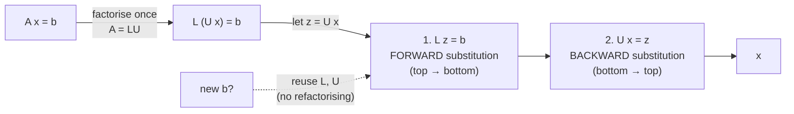
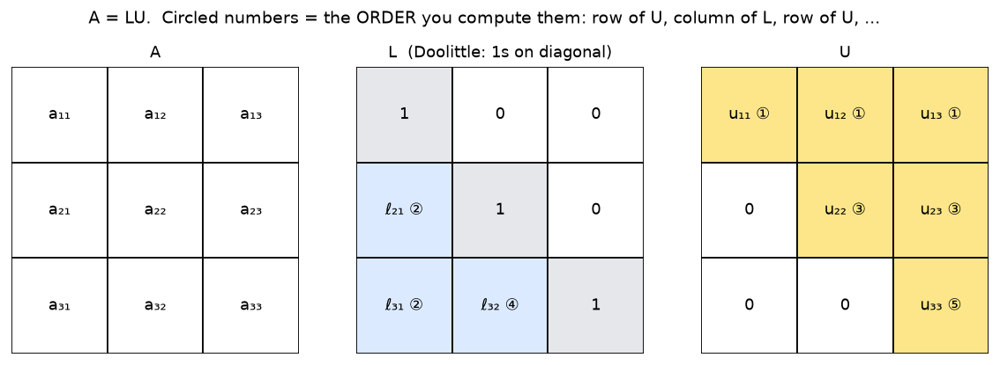

# Week 12: Linear Systems: Triangular Solves & LU Factorisation

> **The point:** solve $A\mathbf x=\mathbf b$ ($n$ equations, $n$ unknowns). **Triangular** systems are easy: you solve one unknown at a time. So **factorise** a general $A$ into a lower triangular $L$ times an upper triangular $U$, and solve two easy triangular systems instead of one hard one.
>
> **Why bother?** In practice the **same $A$** often comes with **many different $\mathbf b$'s**. Factorising is the expensive part (about $n^3$ operations) and you do it **once**. Each new $\mathbf b$ then costs only two cheap triangular solves (about $n^2$ each).

**Exam link:** **Q15 (5 marks, every year):** fill in the missing entries of a partial LU factorisation, then solve using it, or explain in words how you would.

---

## 1. Forward substitution (lower triangular)

$$x_i=\frac{b_i-\sum_{j=1}^{i-1}a_{ij}x_j}{a_{ii}},\qquad i=1,2,\dots,n$$

**Lecture example:** $\begin{bmatrix}3&0&0\\-1&2&0\\-2&3&5\end{bmatrix}\mathbf x=\begin{bmatrix}3\\3\\19\end{bmatrix}$
- $3x_1=3\Rightarrow x_1=1$
- $-1+2x_2=3\Rightarrow x_2=2$
- $-2+6+5x_3=19\Rightarrow x_3=3$

**2025 Q15a:** $\begin{bmatrix}3&0\\-2&5\end{bmatrix}\mathbf x=\begin{bmatrix}12\\-23\end{bmatrix}$. Then $x_1=4$, and $-8+5x_2=-23\Rightarrow x_2=-3$.

## 2. Backward substitution (upper triangular)

$$x_i=\frac{b_i-\sum_{j=i+1}^{n}a_{ij}x_j}{a_{ii}},\qquad i=n,n-1,\dots,1$$

Start from the **last** row.

---

## 3. LU factorisation (Doolittle: $L$ has **1s on its diagonal**)

$$\underbrace{\begin{bmatrix}a_{11}&a_{12}&a_{13}\\a_{21}&a_{22}&a_{23}\\a_{31}&a_{32}&a_{33}\end{bmatrix}}_A=\underbrace{\begin{bmatrix}1&0&0\\\ell_{21}&1&0\\\ell_{31}&\ell_{32}&1\end{bmatrix}}_L\underbrace{\begin{bmatrix}u_{11}&u_{12}&u_{13}\\0&u_{22}&u_{23}\\0&0&u_{33}\end{bmatrix}}_U$$

**Multiply out and equate entries.** Each entry of $A$ = (row of $L$) · (column of $U$). Solve in the order **row 1 of U → column 1 of L → row 2 of U → column 2 of L → …**:

| Order | Entries | Formula |
|---|---|---|
| ① | $u_{11},u_{12},u_{13}$ | $u_{1j}=a_{1j}$ |
| ② | $\ell_{21},\ell_{31}$ | $\ell_{i1}=a_{i1}/u_{11}$ |
| ③ | $u_{22},u_{23}$ | $u_{22}=a_{22}-\ell_{21}u_{12}$, $\ u_{23}=a_{23}-\ell_{21}u_{13}$ |
| ④ | $\ell_{32}$ | $\ell_{32}=\dfrac{a_{32}-\ell_{31}u_{12}}{u_{22}}$ |
| ⑤ | $u_{33}$ | $u_{33}=a_{33}-\ell_{31}u_{13}-\ell_{32}u_{23}$ |

**General pattern:** $u_{ij}=a_{ij}-\sum_{k<i}\ell_{ik}u_{kj}$ and $\ell_{ij}=\dfrac{a_{ij}-\sum_{k<j}\ell_{ik}u_{kj}}{u_{jj}}$.

> 💡 **You don't need to memorise the formulas.** For any single missing entry, multiply the matching **row of $L$** by the **column of $U$**, set it equal to $a_{ij}$, and solve. The solutions say this is fully acceptable.

---

## 4. Worked: 2024 Q15 (5 marks)

$$A=\begin{bmatrix}2&1&-4\\-4&-5&10\\6&6&-10\end{bmatrix}=\begin{bmatrix}1&0&0\\-2&1&0\\3&\ell_{32}&1\end{bmatrix}\begin{bmatrix}2&1&-4\\0&u_{22}&2\\0&0&u_{33}\end{bmatrix},\qquad\mathbf b=\begin{bmatrix}2\\-12\\10\end{bmatrix}$$

**(a)**
- $u_{22}=a_{22}-\ell_{21}u_{12}=-5-(-2)(1)=\boxed{-3}$
- $\ell_{32}=\dfrac{a_{32}-\ell_{31}u_{12}}{u_{22}}=\dfrac{6-3(1)}{-3}=\boxed{-1}$
- $u_{33}=a_{33}-\ell_{31}u_{13}-\ell_{32}u_{23}=-10-3(-4)-(-1)(2)=\boxed{4}$

**(b)** You're given $\mathbf z=[2,-8,-4]^T$ (the solution of $L\mathbf z=\mathbf b$). Now solve $U\mathbf x=\mathbf z$ by **backward** substitution:
- $4x_3=-4\Rightarrow x_3=-1$
- $-3x_2+2(-1)=-8\Rightarrow x_2=2$
- $2x_1+2-4(-1)=2\Rightarrow x_1=-2$

$$\mathbf x=[-2,\ 2,\ -1]^T$$

### Other years
| Exam | Answer |
|---|---|
| 2025 Q15b, $A=\begin{bmatrix}3&-1&1\\3&1&-1\\-6&-10&11\end{bmatrix}$ | $\ell_{21}=\frac33=1$; $\ell_{32}=\frac{-10-(-2)(-1)}{2}=-6$; $u_{33}=11-(-2)(1)-(-6)(-2)=1$ |
| 2023 Q15a, $A=\begin{bmatrix}-4&3&3\\-8&5&7\\4&-5&-4\end{bmatrix}$ | $u_{22}=5-2(3)=-1$; $\ell_{32}=\frac{-5-(-1)(3)}{-1}=2$ |

### 2023 Q15b: "Explain in words how LU solves $A\mathbf x=\mathbf b$" (3 marks)
> Replace $A$ by $LU$, so $(LU)\mathbf x=\mathbf b$, i.e. $L(U\mathbf x)=\mathbf b$. Let $\mathbf z=U\mathbf x$. **[1]**
> 1. Solve $L\mathbf z=\mathbf b$ for $\mathbf z$ using **forward substitution**. **[1]**
> 2. Solve $U\mathbf x=\mathbf z$ for $\mathbf x$ using **backward substitution**. **[1]**

---

## 5. Lecture 4×4 example (good full practice)

$$A=\begin{bmatrix}2&3&3&1\\6&13&12&9\\4&2&1&4\\2&7&8&17\end{bmatrix}=\begin{bmatrix}1&0&0&0\\3&1&0&0\\2&-1&1&0\\1&1&-1&1\end{bmatrix}\begin{bmatrix}2&3&3&1\\0&4&3&6\\0&0&-2&8\\0&0&0&18\end{bmatrix}$$

With $\mathbf b=[6,25,7,29]^T$: forward substitution gives $\mathbf z=[6,7,2,18]^T$, and backward substitution gives $\mathbf x=[1,-2,3,1]^T$.

---

## 6. Pivoting (concept only)

LU **divides by the pivots** $u_{jj}$. If a pivot is **zero**, the method breaks down. If it's **tiny**, everything gets scaled up and roundoff errors grow, so plain LU is **numerically unstable**. **Pivoting** (swapping rows so the pivot is as large as possible) fixes this. It isn't covered in detail in MXB103 (see MXB226).

---

## Where do linear systems come from? (lecture problems)

- **Interpolation** (Week 5): finding $a_0,a_1,a_2$ in $P_2=a_0+a_1x+a_2x^2$ through 3 points is a $3\times3$ system.
- **Word problems:** e.g. three children's ages sum to 23; 8 years ago the oldest was 4× the middle; in 5 years the youngest will be half the middle. This gives
$x_1+x_2+x_3=23,\quad x_1-4x_2=-24,\quad -x_2+2x_3=-5$, so $\mathbf x=(12,9,2)$.

---

## Traps

- In Doolittle, $L$ has **1s** on its diagonal, so $u_{11}=a_{11}$ directly.
- Watch signs: $u_{33}=a_{33}-\ell_{31}u_{13}-\ell_{32}u_{23}$, and a negative times a negative is subtracted.
- The given $\mathbf z$ is the **intermediate** vector. Don't stop there: you still need $U\mathbf x=\mathbf z$.
- Check your answer: $A\mathbf x$ should equal $\mathbf b$. It's quick and catches sign errors.

---

## Practice

**P1.** Find the LU factorisation of $A=\begin{bmatrix}2&1&1\\4&3&3\\8&7&9\end{bmatrix}$ and solve $A\mathbf x=[4,10,24]^T$.

Answer

$L=\begin{bmatrix}1&0&0\\2&1&0\\4&3&1\end{bmatrix}$, $U=\begin{bmatrix}2&1&1\\0&1&1\\0&0&2\end{bmatrix}$

Forward: $z_1=4$; $8+z_2=10\Rightarrow z_2=2$; $16+6+z_3=24\Rightarrow z_3=2$.

Backward: $2x_3=2\Rightarrow x_3=1$; $x_2+1=2\Rightarrow x_2=1$; $2x_1+1+1=4\Rightarrow x_1=1$.

So $\mathbf x=[1,1,1]^T$.

**P2.** Solve by backward substitution: $\begin{bmatrix}5&1&4&-1\\0&-4&-9&1\\0&0&-3&2\\0&0&0&-8\end{bmatrix}\mathbf x=\begin{bmatrix}63\\-68\\-6\\-48\end{bmatrix}$

Answer

$x_4=6$, $x_3=6$, $x_2=5$, $x_1=8$

