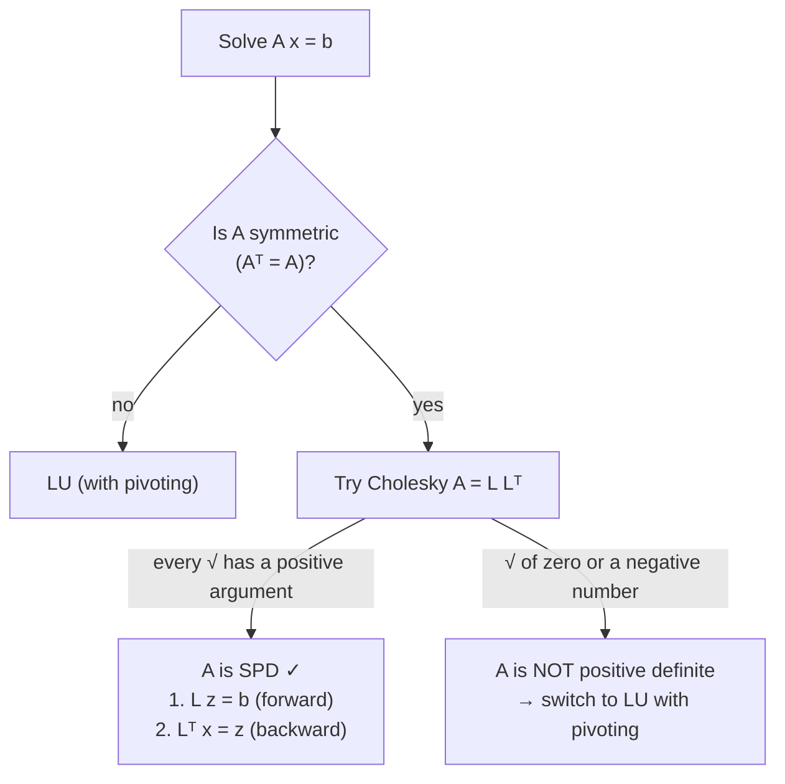
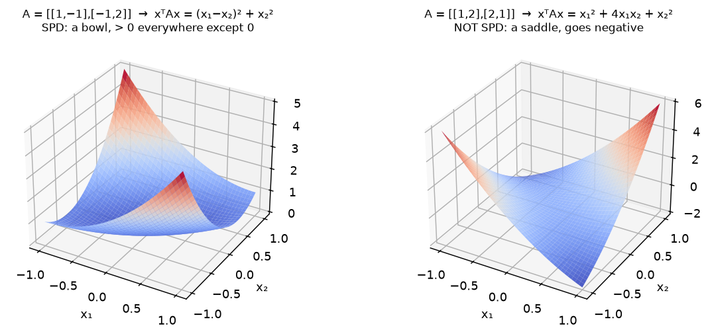

# Week 13: Symmetric Positive Definite Matrices & Cholesky Factorisation

> **The point:** many matrices in practice are **symmetric positive definite (SPD)**. For these, $A$ factorises as $LL^T$ (one triangular matrix and its own transpose). That's **about half the work** of LU, **never needs pivoting**, is **always numerically stable**, and doubles as **the fastest test for whether a symmetric matrix is positive definite**.

**Exam link:** **Q16 (4–6 marks, every year):** fill in the missing Cholesky entries, show that a matrix is positive definite, or state what properties $A$ needs.

---

## 1. Definitions

- **Transpose** $A^T$: rows become columns.
- **Symmetric:** $A^T=A$ (mirror image across the diagonal).
- **Positive definite:** $\mathbf x^TA\mathbf x>0$ for **every nonzero** vector $\mathbf x$.
- **SPD** = symmetric **and** positive definite.

**2023 Q16a: "What properties does $A$ need for Cholesky?"** Answer: $A$ must be **symmetric** [1] and **positive definite** [1].

### Geometric meaning
$\mathbf x^TA\mathbf x$ is a quadratic "surface". **Positive definite means it's a bowl**: positive everywhere except at the origin.

---

## 2. Showing positive definiteness by completing the square

**2025 Q16a (3 marks):** show $\begin{bmatrix}1&-1\\-1&2\end{bmatrix}$ is positive definite.

> We need $\mathbf x^TA\mathbf x>0$ for all $\mathbf x\ne\mathbf0$. **[1]**
> $$\mathbf x^TA\mathbf x=\begin{bmatrix}x_1&x_2\end{bmatrix}\begin{bmatrix}x_1-x_2\\-x_1+2x_2\end{bmatrix}=x_1(x_1-x_2)+x_2(-x_1+2x_2)=x_1^2-2x_1x_2+2x_2^2\quad\textbf{[1]}$$
> $$=\underbrace{x_1^2-2x_1x_2+x_2^2}_{(x_1-x_2)^2}+x_2^2=(x_1-x_2)^2+x_2^2\quad\textbf{[0.5]}$$
> A sum of squares is $\ge0$, and it equals 0 only when $x_2=0$ **and** $x_1=x_2$, i.e. $\mathbf x=\mathbf0$. Hence it is positive definite. **[0.5]**

**Shortcut for 2×2** $\begin{bmatrix}a&b\\b&c\end{bmatrix}$: $\mathbf x^TA\mathbf x=ax_1^2+2bx_1x_2+cx_2^2$. Notice the **2** on the cross term: the two off-diagonal entries together contribute $2b$.

**Completing the square in general:** $ax_1^2+2bx_1x_2=a\left(x_1+\frac bax_2\right)^2-\frac{b^2}{a}x_2^2$.

---

## 3. Cholesky factorisation $A=LL^T$

$$\underbrace{\begin{bmatrix}a_{11}&a_{21}&a_{31}\\a_{21}&a_{22}&a_{32}\\a_{31}&a_{32}&a_{33}\end{bmatrix}}_{A}=\underbrace{\begin{bmatrix}\ell_{11}&0&0\\\ell_{21}&\ell_{22}&0\\\ell_{31}&\ell_{32}&\ell_{33}\end{bmatrix}}_{L}\underbrace{\begin{bmatrix}\ell_{11}&\ell_{21}&\ell_{31}\\0&\ell_{22}&\ell_{32}\\0&0&\ell_{33}\end{bmatrix}}_{L^T}$$

Here $L$ does **not** have 1s on its diagonal. Equate entries and work **column by column**:

| Column | Formulas |
|---|---|
| 1 | $\ell_{11}=\sqrt{a_{11}}$, $\quad\ell_{21}=\dfrac{a_{21}}{\ell_{11}}$, $\quad\ell_{31}=\dfrac{a_{31}}{\ell_{11}}$ |
| 2 | $\ell_{22}=\sqrt{a_{22}-\ell_{21}^2}$, $\quad\ell_{32}=\dfrac{a_{32}-\ell_{31}\ell_{21}}{\ell_{22}}$ |
| 3 | $\ell_{33}=\sqrt{a_{33}-\ell_{31}^2-\ell_{32}^2}$ |

**Pattern:**
- **Diagonal:** $\sqrt{a_{jj}-\text{(sum of squares of the row so far)}}$
- **Below the diagonal:** $\dfrac{a_{ij}-\text{(dot product of the two rows so far)}}{\ell_{jj}}$

Take the **positive** square root.

**Solve:** $L\mathbf z=\mathbf b$ (forward), then $L^T\mathbf x=\mathbf z$ (backward).

---

## 4. Worked (past exams)

| Exam | $A$ | Missing entries |
|---|---|---|
| **2025 Q16b** | $\begin{bmatrix}36&-12&-6\\-12&13&11\\-6&11&35\end{bmatrix}$ | $\ell_{11}=\sqrt{36}=6$; $\ \ell_{32}=\frac{11-(-1)(-2)}{3}=3$; $\ \ell_{33}=\sqrt{35-1-9}=5$ |
| **2024 Q16a** | $\begin{bmatrix}9&-3&-6\\-3&2&4\\-6&4&33\end{bmatrix}$ | $\ell_{21}=\frac{-3}{3}=-1$; $\ \ell_{32}=\frac{4-(-2)(-1)}{1}=2$; $\ \ell_{33}=\sqrt{33-4-4}=5$ |
| **2023 Q16b** | $\begin{bmatrix}16&-4&8\\-4&2&-4\\8&-4&12\end{bmatrix}$ | $\ell_{21}=\frac{-4}{4}=-1$; $\ \ell_{33}=\sqrt{12-2^2-(-2)^2}=2$ |

**2024 Q16b: "Is $A$ SPD? Explain."** (1 mark)
> Yes. $A$ is symmetric, and the Cholesky factorisation **succeeded** (all diagonal entries of $L$ are real and positive), so $A$ is positive definite.

### Lecture example (full solve)
$$\begin{bmatrix}16&4&8\\4&5&-4\\8&-4&22\end{bmatrix}\mathbf x=\begin{bmatrix}20\\17\\28\end{bmatrix},\qquad L=\begin{bmatrix}4&0&0\\1&2&0\\2&-3&3\end{bmatrix}$$
- $\ell_{11}=4$, $\ell_{21}=1$, $\ell_{31}=2$
- $\ell_{22}=\sqrt{5-1}=2$, $\ell_{32}=\frac{-4-2}{2}=-3$
- $\ell_{33}=\sqrt{22-4-9}=3$

Forward: $\mathbf z=[5,6,12]^T$. Backward with $L^T$: $x_3=4$, $x_2=9$, $x_1=-3$.

---

## Step-by-step: what each step is doing

### Showing positive definiteness

| Step | What you do | Why |
|---|---|---|
| 1 | State the goal: $\mathbf x^TA\mathbf x>0$ for all $\mathbf x\ne\mathbf0$ | The definition, worth a mark |
| 2 | Compute $A\mathbf x$, then $\mathbf x^T(A\mathbf x)$ | This gives a quadratic in $x_1,x_2,\dots$ |
| 3 | Complete the square(s) | Rewrite it as a **sum of squares** with positive coefficients |
| 4 | Argue it is $\ge0$, with equality only when all the squared terms are zero, which forces $\mathbf x=\mathbf0$ | Strict positivity for nonzero $\mathbf x$ |

### Worked example A: a 3×3 case, $A=\begin{bmatrix}2&-1&0\\-1&2&-1\\0&-1&2\end{bmatrix}$

- **Step 2:** $\mathbf x^TA\mathbf x=2x_1^2+2x_2^2+2x_3^2-2x_1x_2-2x_2x_3$
- **Step 3:** split each $2x_i^2$ so the cross terms pair up:
$$=x_1^2+\underbrace{(x_1^2-2x_1x_2+x_2^2)}_{(x_1-x_2)^2}+\underbrace{(x_2^2-2x_2x_3+x_3^2)}_{(x_2-x_3)^2}+x_3^2$$
- **Step 4:** a sum of squares is $\ge0$. It is zero only if $x_1=0$, $x_1=x_2$, $x_2=x_3$ and $x_3=0$, i.e. $\mathbf x=\mathbf0$. So $A$ is PD ✓

### Computing L (column by column)

| Step | Entry | Formula | Where it comes from |
|---|---|---|---|
| 1 | $\ell_{11}$ | $\sqrt{a_{11}}$ | $a_{11}=\ell_{11}^2$ |
| 2 | $\ell_{21},\ell_{31}$ | $a_{i1}/\ell_{11}$ | $a_{i1}=\ell_{i1}\ell_{11}$ |
| 3 | $\ell_{22}$ | $\sqrt{a_{22}-\ell_{21}^2}$ | $a_{22}=\ell_{21}^2+\ell_{22}^2$ |
| 4 | $\ell_{32}$ | $(a_{32}-\ell_{31}\ell_{21})/\ell_{22}$ | $a_{32}=\ell_{31}\ell_{21}+\ell_{32}\ell_{22}$ |
| 5 | $\ell_{33}$ | $\sqrt{a_{33}-\ell_{31}^2-\ell_{32}^2}$ | $a_{33}=\ell_{31}^2+\ell_{32}^2+\ell_{33}^2$ |
| 6 | solve | $L\mathbf z=\mathbf b$ (forward), then $L^T\mathbf x=\mathbf z$ (backward) | $A=LL^T$ |

> If any square root has a **negative** argument (or zero), stop: $A$ is not positive definite.

### Worked example B: $A=\begin{bmatrix}9&3&-3\\3&5&1\\-3&1&6\end{bmatrix}$, $\mathbf b=[0,0,8]^T$

- **Step 1:** $\ell_{11}=\sqrt9=3$
- **Step 2:** $\ell_{21}=\frac33=1$ and $\ell_{31}=\frac{-3}{3}=-1$
- **Step 3:** $\ell_{22}=\sqrt{5-1^2}=2$
- **Step 4:** $\ell_{32}=\frac{1-(-1)(1)}{2}=1$
- **Step 5:** $\ell_{33}=\sqrt{6-(-1)^2-1^2}=2$

$$L=\begin{bmatrix}3&0&0\\1&2&0\\-1&1&2\end{bmatrix}$$

All the square roots worked, so $A$ is SPD.

- **Step 6, forward** ($L\mathbf z=\mathbf b$): $3z_1=0\Rightarrow z_1=0$; $z_1+2z_2=0\Rightarrow z_2=0$; $-z_1+z_2+2z_3=8\Rightarrow z_3=4$
- **Step 6, backward** ($L^T\mathbf x=\mathbf z$, with $L^T=\begin{bmatrix}3&1&-1\\0&2&1\\0&0&2\end{bmatrix}$): $2x_3=4\Rightarrow x_3=2$; $2x_2+2=0\Rightarrow x_2=-1$; $3x_1-1-2=0\Rightarrow x_1=1$

$$\mathbf x=[1,-1,2]^T$$
Check: row 1 of $A\mathbf x$ is $9-3-6=0$ ✓

---

## 5. Why Cholesky? (comparison)

| | LU (Doolittle) | Cholesky |
|---|---|---|
| Works for | general $A$ (with pivoting) | **SPD only** |
| Factors | $L$ (unit diagonal), $U$ | $L$, $L^T$ (store only one!) |
| Work | baseline | about **half** |
| Pivoting needed? | yes, for stability | **never** |
| Bonus | — | succeeds ⇔ $A$ is SPD (a cheap test) |

**A failed Cholesky = not positive definite.** e.g. $\begin{bmatrix}1&2\\2&1\end{bmatrix}$: $\ell_{11}=1$, $\ell_{21}=2$, $\ell_{22}=\sqrt{1-4}=\sqrt{-3}$ ✗. Indeed $\mathbf x=(1,-1)$ gives $1-4+1=-2<0$ (the saddle in the figure).

---

## Traps

- In $\ell_{32}$ the subtraction is $\ell_{31}\ell_{21}$ (two entries of $L$), **not** $\ell_{31}u_{12}$ as in LU.
- Diagonal entries need a square root. Off-diagonal entries need a division.
- Fill-in questions give you some entries of $L$ already. **Use them** rather than recomputing.
- "Positive definite" means **strictly** $>0$ for all **nonzero** $\mathbf x$. Say "equals zero only when $\mathbf x=\mathbf 0$".

---

## Practice

**P1.** Show that $A=\begin{bmatrix}2&1&0\\0&3&0\\0&0&4\end{bmatrix}$ is positive definite (lecture problem).

Answer

$\mathbf x^TA\mathbf x=2x_1^2+x_1x_2+3x_2^2+4x_3^2=2\left(x_1+\tfrac{x_2}{4}\right)^2-\tfrac{x_2^2}{8}+3x_2^2+4x_3^2=2\left(x_1+\tfrac{x_2}4\right)^2+\tfrac{23}{8}x_2^2+4x_3^2>0$ unless $\mathbf x=\mathbf0$.

**P2.** Cholesky-factorise $A=\begin{bmatrix}4&2&-2\\2&10&2\\-2&2&6\end{bmatrix}$ and solve $A\mathbf x=[6,24,8]^T$.

Answer

$\ell_{11}=2,\ \ell_{21}=1,\ \ell_{31}=-1,\ \ell_{22}=\sqrt{10-1}=3,\ \ell_{32}=\frac{2-(-1)(1)}{3}=1,\ \ell_{33}=\sqrt{6-1-1}=2$

Forward ($L\mathbf z=\mathbf b$): $z_1=3$; $3+3z_2=24\Rightarrow z_2=7$; $-3+7+2z_3=8\Rightarrow z_3=2$.

Backward ($L^T\mathbf x=\mathbf z$): $2x_3=2\Rightarrow x_3=1$; $3x_2+1=7\Rightarrow x_2=2$; $2x_1+2-1=3\Rightarrow x_1=1$.

So $\mathbf x=[1,2,1]^T$.

**P3.** Lecture problem: solve $\begin{bmatrix}4&2&-1\\2&4&1\\-1&1&4\end{bmatrix}\mathbf x=\begin{bmatrix}10\\8\\-7\end{bmatrix}$ with Cholesky.

Answer

$L=\begin{bmatrix}2&0&0\\1&\sqrt3&0\\-\frac12&\frac{\sqrt3}{2}&\sqrt3\end{bmatrix}$, $\mathbf z=\left[5,\ \sqrt3,\ -2\sqrt3\right]^T$, $\mathbf x=[1,2,-2]^T$

